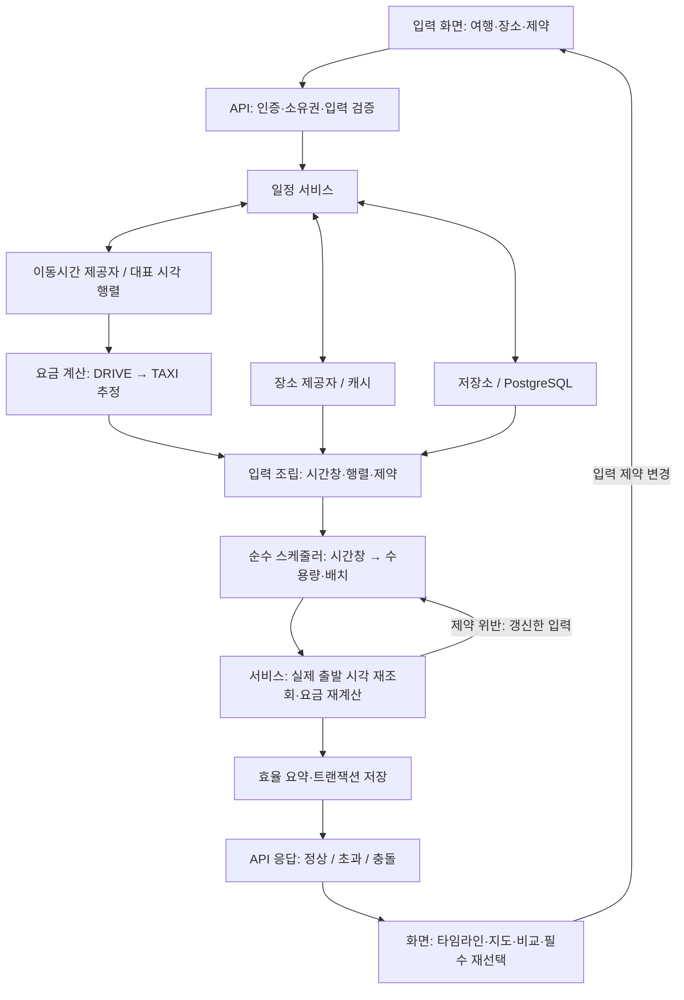

# 아키텍처

기준: 2026-11-18, T7A 감사와 T8 시작 시 `develop`의 `8314457`을 바탕으로 갱신.
[요구사항](requirements.md)의 확정/추천/미정 구분은 그대로 유지한다.
**현재**는 T1–T8에 있는 코드, **후속 계약**은 아직 구현하지 않은 경계다. 후속 계약에 적힌
디렉터리·서비스·HTTP 응답은 아직 존재하지 않는다. 구조나 계약 변경 시 이 문서와
[결정 기록](decisions/0001-pure-core-and-service-boundaries.md)을 같은 PR에서 갱신한다.

## 1. 폴더 구조와 모듈 경계

```text
src/
  app/                         현재: App Router, 홈/manifest, 서버 액션
    api/auth/[...nextauth]/     현재: Auth.js HTTP 진입점
    api/trips/[id]/             현재: 소유권 확인 후 { id }만 반환
    api/places/                 현재 T8: 인증된 한국어 검색·상세·좌표 조회
  components/service-worker.tsx  현재: 프로덕션 서비스워커 등록
  auth.ts                      현재: Google 공급자, JWT/세션 콜백 구성
  lib/
    db.ts                      현재: 명시적 PostgreSQL Pool 팩터리
    auth/                      현재: 인증 포트/콜백, 권한, SQL 저장소
  scheduler/
    index.ts                   현재: 시간창·식사 슬롯, 공개 export
    placement.ts               현재: 고정/필수 배치, 지리적 순서, 삽입·2-opt
    transport.ts               현재: 정책·수동 지정에 따른 이동수단 선택
    capacity.ts                현재: 실제 배치 기반 수용량·추천 검증
  fare/index.ts                현재: 도시 프로필 타입, 순수 택시 요금 계산
  places/                      현재 T8: 장소 포트·좌표 캐시·Google 어댑터·HTTP 처리
  travel-time/                 후속 T9: 이동시간 포트·캐시·Google 어댑터
  repositories/                후속 T10/T12: 여행·장소 ID·프로필·일정 SQL 경계
  services/itinerary.ts         후속 T12: 입력 조립, 재조회 루프, 결과 저장
migrations/                    현재: 001 인증 → 002 여행 → 003 심야 시간대
public/                        현재: 온라인 전용 sw.js, 아이콘
tests/                         현재: node:test + tsx, SQL/HTTP/순수 함수 검사
scripts/verify-pwa.mjs          현재: 빌드 산출물 검사
docs/decisions/                설계 결정과 대안
```

| 경계 | 책임과 허용 의존성 | 경계 밖의 일 |
|---|---|---|
| `src/app`, `src/auth.ts` | 세션 확인, 입력 검증, HTTP/화면 변환, 서버 서비스 호출 | 스케줄링 알고리즘, 브라우저에서 DB/비밀 키 접근 |
| 인증 코어 | [AuthStore](../src/lib/auth/callbacks.ts)와 `authorizeTrip` 콜백에만 의존 | Google/SQL 구현을 콜백에 직접 결합 |
| `src/scheduler` | 호출자가 제공한 시간창·행렬만 계산. 런타임 의존성은 내부 모듈과 Temporal | DB, fetch, 공급자 호출, 환경 변수, 현재 시각·난수 읽기 |
| `src/fare` | 프로필·거리·주행시간·출발 instant·시간대에서 추정 요금 산출 | 요금표 조사, DB 조회, 환율 조회 |
| 후속 서비스 | 저장소/제공자 주입, 좌표·영업시간 갱신, 순수 함수 호출 순서, 재검증 | HTTP 객체를 코어에 전달, 고정 제약의 임의 해제 |
| 후속 제공자 | 외부 응답/단위 정규화, 캐시, 네트워크 실패 구분 | 정책에 맞는 이동수단 선택, 사용자 입력 변경 |
| 저장소 | SQL, 트랜잭션, 행→도메인 변환, 소유 데이터 연쇄 삭제 | 스케줄러 실행, 외부 API 호출 |

현재 `placement.ts`는 `CityProfile`의 두 필드만 **type import**하고, `index.ts`의 타입도
type import한다. 런타임에는 `index → capacity → placement → transport`와
`index → placement/transport`가 연결된다. 전역 가변 캐시를 코어에 넣지 않는다.
`ReadonlyMap`/readonly 배열 입력을 바꾸지 않고 결과를 새로 반환한다.

현재 SQL 구현은 [auth/store.ts](../src/lib/auth/store.ts)에 있다. 새 저장소는 같은 `pg` 풀을
주입받는 방식으로 추가하고 기존 인증 저장소 이동은 별도 작업에서 필요할 때 결정한다.
풀은 서버 프로세스에서 재사용하고 종료 시 닫는다. 빌드·모듈 import 시 연결하지 않는다.

## 2. 데이터 흐름

현재 연결된 실행 흐름은 `홈/서버 액션 → Auth.js → 인증 저장소 → PostgreSQL`,
`GET /api/trips/[id] → auth → authorizeTrip → tripOwner → { id }`,
`GET /api/places → auth → PlaceProvider → Google/좌표 캐시`다.
스케줄러·요금 함수는 테스트에서 호출하며 아직 API/화면과 연결되지 않았다.

다음은 T8–T13에서 연결할 흐름이다. 화살표는 데이터 이동이며 호출 주체는 API의 서비스다.



1. 서버가 사용자와 여행 소유자를 확인한다. 클라이언트의 `ownerId`, 비용, 계산 결과는 신뢰하지 않는다.
2. 여행 기본값과 날짜별 덮어쓰기를 조합하고 장소 캐시의 유효성을 확인한다. 미완성 T2 여행은
   누락 필드를 알려 입력 완료를 요청한다. 임의 도시·시간대를 넣지 않는다.
3. 날짜별 대표 출발 instant로 방향성 이동 행렬을 조회한다. 공항↔숙소 경유·짐 처리 시간을
   합산해 `calculateDayWindow`에 전달한다. 공항 이동은 일일 행렬 경로와 중복 차감하지 않는다.
4. DRIVE의 거리와 **주행시간**으로 택시 요금을 계산한 뒤 `RouteOptions.TAXI`로 바꾼다.
   호출 대기 버퍼는 `selectTravelMode`가 시간에 한 번 더한다. 모든 비교 비용은 같은 현지 통화다.
5. `checkCapacity`가 내부에서 `scheduleVisits`를 반복 실행한다. 단계 3의 판정은 단계 4–6의
   실제 배치 성공에 근거한다. 희망 장소는 고정한 경우에만 배치한다.
6. T12 서비스가 선택된 구간을 실제 출발 instant로 재조회하고 요금·영업시간·시간창을 다시 검사한다.
   위반 시 고정 제약을 유지한 입력으로 재배치한다. 시도 상한과 동일 입력 해시 탐지로 종료하며,
   상한은 T12에서 픽스처/실행시간 근거와 함께 결정한다. 실패한 일정을 `OK`로 저장하지 않는다.
7. 대중교통 기준과 정책 적용 결과의 이동시간·요금을 집계한다. 미상 요금은 0으로 합산하지 않는다.
   마지막 검증에 사용한 입력/행렬 버전과 결과를 함께 저장하고 API에서 JSON으로 직렬화한다.
8. 초과 시 원래 요청의 실패 진단, 검증된 추천 조합, 희망 장소를 구분해서 표시한다.
   선택 변경은 `REQUIRED`/`WISH` 및 고정 제약을 다시 저장하고 같은 파이프라인을 실행한다.

서비스가 I/O를 수행하며 스케줄러가 이동시간/요금 제공자를 호출하는 역방향 의존은 없다.
상세 판단 근거는 [ADR 0001](decisions/0001-pure-core-and-service-boundaries.md)에 있다.

## 3. 현재 핵심 인터페이스

실제 정의는 [scheduler/index.ts](../src/scheduler/index.ts),
[placement.ts](../src/scheduler/placement.ts), [capacity.ts](../src/scheduler/capacity.ts),
[transport.ts](../src/scheduler/transport.ts), [fare/index.ts](../src/fare/index.ts)를 따른다.
이 문서의 TypeScript 블록은 한 모듈로 합쳐 실제 export와 함께 strict 타입 검사한다.

```typescript
import {
  calculateDayWindow, checkCapacity, scheduleVisits, selectTravelMode,
  type DayWindowInput, type DayWindowResult, type MealSlot, type MealWindows,
  type TimeWindow, type ScheduleInput, type ScheduleResult, type CapacityResult,
  type Visit, type TaxiPolicy, type RouteOptions,
} from '../src/scheduler';
import { estimateTaxiFare, type CityProfile } from '../src/fare';

export const schedulerContract: {
  calculateDayWindow(input: DayWindowInput): DayWindowResult;
  scheduleVisits(input: ScheduleInput): ScheduleResult;
  checkCapacity(input: ScheduleInput): CapacityResult;
  selectTravelMode: typeof selectTravelMode;
} = { calculateDayWindow, scheduleVisits, checkCapacity, selectTravelMode };

export interface FareProvider {
  estimateTaxiFare: typeof estimateTaxiFare;
}
export const fareProvider: FareProvider = { estimateTaxiFare };
```

| 입력/출력 | 계약 |
|---|---|
| `DayWindowInput` | 현지 `date`, IANA `timeZone`, 같은 날의 활동 `HH:mm` 구간, `mealCount` 0–3, 선택적 식사창·도착/출발 항공 제약. `travelMinutes`는 숙소 경유/짐 처리까지 포함한 전체 공항 이동시간 |
| `DayWindowResult` | `timeZone`, UTC instant 시간창 `available` 또는 null, `{slot, window|null}[]`, 공항 이동의 시간과 `viaLodging` |
| `ScheduleInput.days` | 날짜, 시간창 결과, 시작·종료 location ID, 방향성 `ReadonlyMap<from, ReadonlyMap<to, RouteOptions>>`, 날짜/방향별 수동 수단·짐 플래그 |
| `ScheduleInput.visits` | 고유 방문 ID, 장소 ID, 좌표, 체류 분, `REQUIRED/WISH`, 선택적 날짜·instant·0부터 세는 방문 순서 고정, 여행 전체의 영업 instant 창 |
| 나머지 `ScheduleInput` | 슬롯별 식사 소요 분, `NEVER/WHEN_NEEDED/PREFER`, 선택적 호출 버퍼·분당 추가비용 기준 |
| `RouteOptions` | `TRANSIT/WALK/TAXI`별 선택적 `{minutes, fare:number|null}`. 수단 없음은 경로 없음, `fare:null`은 요금만 미상. TAXI minutes에는 호출 대기가 아직 없음 |
| `ScheduleResult` | 날짜·IANA 시간대, `VISIT/MEAL` stops, 선택 수단·사용자 고정 여부·요금·instant가 있는 legs, 미배치 ID/사유/고정 여부, 날짜별 issues |
| `CapacityResult` | `OK/OVER_CAPACITY`이면 검증된 `recommendation`, `CONFLICT`이면 null. 원래 요청의 실패 `unplaced/issues`, 가용 분·체류/식사 분·이동/전체 필요시간 하한 |
| `CapacityRecommendation` | `requiredCount` N, `requiredVisitIds`, 실제 재배치한 `schedule`. 고정 필수는 N에 포함, 고정 희망은 제외. 최대해 보장은 아님 |
| `estimateTaxiFare` | `(CityProfile|null|undefined, distanceKm, durationMinutes, departure:Date, timeZone) → TaxiFareEstimate`. 출처·갱신일·통화·`estimated:true` 또는 `UNAVAILABLE/정보 없음` |

고정 순서는 식사를 제외한 방문 위치다. `openingHours` 생략은 미상, `[]`는 방문 불가다.
식사는 직전 위치에서 슬롯 시간을 확보하며 식당 방문과 자동 결합하지 않는다. 직접 고른
이동수단은 택시 정책보다 우선한다. 그 수단이 없으면 대체하지 않고 경로 없음으로 진단한다.
`CONFLICT`는 휴리스틱이 유효한 조합을 찾지 못했다는 뜻이지 불가능성의 수학적 증명이 아니다.
시간 하한만으로 수용 여부를 판단하지 않는다. 다른 N개 조합도 반드시 재검증한다.
[T7 인계](t7-handoff.md)의 추천 재현 방식은 유지한다.

## 4. 후속 제공자와 저장소 계약

장소 포트는 **T8 구현**을 직접 참조하며 이동시간/저장소는 **T9/T10/T12 구현 방향**이다.
외부 SDK 타입, `pg` 행, Next.js `Request`를 이 경계 너머로 넘기지 않는다.

```typescript
type Money = { amount: number; currency: string };
type Location = { id: string; coordinates: Visit['coordinates'] };
// T8: 구현과 문서가 같은 계약을 사용한다. location은 캐시 가능한 좌표 조회다.
export type {
  PlaceProvider, PlaceSearchRequest, PlaceDetailsRequest, PlaceSummary, PlaceDetails, PlaceLocation,
} from '../src/places';

type ProviderMode = 'TRANSIT' | 'WALK' | 'DRIVE';
type TravelEstimate = { durationSeconds: number; distanceMeters: number; fare: Money | null };
type TravelAlternatives = Partial<Record<ProviderMode, TravelEstimate>>;
type TravelRequest = {
  departure: string; // 오프셋 있는 instant (ISO 8601)
  timeZone: string;
  modes: readonly ProviderMode[];
};
export interface TravelTimeProvider {
  matrix(input: TravelRequest & { locations: readonly Location[] }):
    Promise<ReadonlyMap<string, ReadonlyMap<string, TravelAlternatives>>>;
  route(input: TravelRequest & { from: Location; to: Location }): Promise<TravelAlternatives>;
}
```

장소 검색은 한국어 요청이며 이름의 한국어 표기가 없는 경우를 허용한다. 내부 `Location.id`는
`places.id`, 방문 ID는 `trip_places.id`, 외부 조회 키는 `google_place_id`다. ID를 혼용하지 않는다.
영업정보 미상은 생략하고, 닫힌 날짜에는 빈 창을 반환한다. null 상세는 장소 없음이다.
외부 장애/쿼터 초과를 null 또는 빈 경로로 숨기지 않는다. DRIVE 요금은 null이며 택시 추정은
FareProvider가 맡는다. 대중교통 요금이 없으면 null을 유지한다.

T8 장소 캐시는 `google:v1:{googlePlaceId}:id,location` 키로 좌표만 기본 24시간 보관한다.
같은 프로세스의 유효 좌표 재조회는 외부 호출이 없고, 동시 요청도 한 번으로 합친다.
이름·유형·영업시간·검색 결과는 저장하지 않으며 상세 응답은 즉시 만료다. 따라서 전체 상세
반복 조회는 외부 호출이 발생한다. 최신 약관 근거, T8 완료 기준 해석의 차이와 저장소 계약
조정은 [ADR 0003](decisions/0003-places-cache-policy.md)에 기록했다. 장소 ID와 Google 상세의
수명을 분리하며 기존 places의 상세 열을 이 프록시에서 채우지 않는다.

API는 `GET /api/places?query=도쿄&regionCode=JP`,
`GET /api/places/{id}?timeZone=Asia/Tokyo&date=2026-11-23`(date 반복 가능),
`GET /api/places/{id}?fields=location`이다. 한국어만 요청하며 인증 전에는 제공자를 만들지 않는다.
응답은 `{places, attribution}` 또는 `{place, attribution}`이며 공급자 attribution도 전달한다.
세부 통합과 UI 표시 책임은 [T8 인계](t8-handoff.md)를 따른다.

이동시간 캐시는 T9에서 출발 instant/모드/방향/좌표 등 결과를 바꾸는 모든 입력을 키에 반영하고,
최신 약관을 별도로 확인해야 한다. 장소 좌표 캐시 정책을 다른 필드나 서비스에 확대하지 않는다.

```typescript
// 저장소가 SQL의 nullable/JSONB/시간 표현을 검증·변환한 입력 스냅샷.
export interface TripInputs {
  id: string;
  ownerId: string;
  cityCode: string;
  timeZone: string;
  startDate: string;
  endDate: string;
  activity: TimeWindow;
  mealSlots: readonly MealSlot[];
  mealWindows: MealWindows;
  taxiPolicy: TaxiPolicy;
  luggageOption: string; // T10에서 입력 값 집합을 확정하고 검증
  arrivalBufferMinutes: number;
  departureBufferMinutes: number;
  daySettings: readonly {
    date: string; departureTime: string | null; returnTime: string | null;
    mealSlots: readonly MealSlot[] | null;
  }[];
  flights: readonly {
    direction: 'ARRIVAL' | 'DEPARTURE'; airportLocationId: string; localDateTime: string;
  }[];
  lodgings: readonly { locationId: string; checkIn: string; checkOut: string }[];
  visits: readonly {
    id: string; locationId: string; kind: 'RESTAURANT' | 'ATTRACTION';
    minutes: number; priority: Visit['priority'];
    fixedDate?: string; fixedTime?: string; fixedOrder?: number;
  }[];
}
export type TripLoad =
  | { status: 'READY'; input: TripInputs; inputHash: string }
  | { status: 'INCOMPLETE'; fields: readonly string[] };
export interface ItinerarySnapshot {
  capacity: CapacityResult;
  comparisons: readonly { date: string; from: string; to: string; options: RouteOptions }[];
  efficiency: {
    currency: string; transitMinutes: number | null; selectedMinutes: number;
    transitFare: number | null; selectedFare: number | null;
  } | null;
}
export interface TripRepository {
  findOwner(tripId: string): Promise<string | null>;
  loadInputs(tripId: string): Promise<TripLoad | null>;
  saveInputs(input: TripInputs): Promise<void>;
  saveItinerary(tripId: string, inputHash: string, result: ItinerarySnapshot): Promise<'SAVED' | 'STALE'>;
}
export interface CityProfileRepository {
  findByCityCode(cityCode: string): Promise<CityProfile | null>;
}
```

위 저장소 계약은 서버 내부에서만 사용한다.
`saveInputs` 전에 서비스가 세션 소유권을 확인하고 요청의 소유자 대신 서버에서 읽은 소유자를 사용한다.
여행 수정과 일정/하위 행 교체는 각각 트랜잭션으로 처리한다. `saveItinerary`는 계산 중 입력이
바뀌었으면 `STALE`을 반환한다. 현재 스키마에 버전 열은 없으므로 T12에서 입력 해시 재검증과
잠금/버전 저장 방식을 구현할 때 결정 기록을 보완한다. JSONB를 타입 단언만으로 읽지 않는다.
T7A의 전체 상세 PlaceRepository 계약은 ADR 0003에 따라 철회했다. 장소 ID 영구 저장은 T10에서 연결한다.

## 5. 저장 형식·시간대 변환

결정 근거: [ADR 0002](decisions/0002-time-storage-and-error-contracts.md).
스키마 원본은 [001](../migrations/001_auth.sql), [002](../migrations/002_travel_model.sql),
[003](../migrations/003_city_profile_night_hours.sql) 순서다. 새 DB도 셋 모두 순서대로 적용한다.
자동 마이그레이션 실행기는 아직 없고 002/003은 반복 실행용이 아니다.

| DB/외부 표현 | 코어 입력으로 변환하는 책임 |
|---|---|
| `date`, `time`, `flights.local_datetime` (timestamp without time zone) | 저장소는 현지 달력 문자열로 읽는다. 호스트 로컬 `Date`로 재해석하지 않는다. 서비스가 Trip의 IANA 시간대로 instant 변환 |
| `timestamptz`, `updated_at`, `cache_expires_at` | 오프셋 있는 ISO instant. 요금 함수에만 `Date`로 전달 |
| PostgreSQL numeric | 저장소에서 유한·비음수 숫자로 검증. `pg`의 기본 numeric 문자열을 그대로 산술에 쓰지 않음 |
| PostgreSQL time `22:00:00` | 분 단위 설정은 `22:00`으로 정규화. 초가 0이 아니면 조용히 자르지 않고 입력 오류 |
| DB 우선순위 `WISHLIST` | 코어 `WISH`로 양방향 명시 변환. SQL enum을 바로 `Visit`로 단언하지 않음 |
| `fixed_date` + `fixed_time` | 여행 시간대에서 `fixedStart` instant로 변환. 날짜 없이 시각만 저장된 행은 입력 보완 필요 |
| 날짜별 null 설정 | 여행 기본값 상속. `meal_slots: []`는 끼니 없음이며 null과 다름 |
| `meal_slots`, `meal_windows` JSONB | 슬롯 집합과 `{start,end}` 검증. 현재 SQL 테스트의 `["11:30","14:00"]` 형태도 변환 필요 |
| 슬롯 집합 → T5의 `mealCount` | `[]/[LUNCH]/[LUNCH,DINNER]/[BREAKFAST,LUNCH,DINNER]`만 수로 직접 변환 가능. `[DINNER]` 등을 길이만 세어 점심으로 바꾸지 않음. T11에서 명시적 슬롯 API/제약을 결정 |
| `stops`/`legs` SQL | 현재 MEAL 슬롯 종류, leg 시간/양 끝점, 사용자 구간 고정 입력 등 저장 필드가 충분하지 않음. T12/T13에서 마이그레이션을 동반해 보완 |

시간은 여행의 IANA 시간대를 항상 함께 전달한다. 현지 입력은 `Temporal`의
`disambiguation: 'reject'`로 변환해 DST에서 존재하지 않거나 두 번 나타나는 시각을 거부한다.
고정 시작·영업시간·행렬 출발은 오프셋 있는 instant다. 산술과 수용량은 실제 경과시간 기준이며
하루를 무조건 24시간으로 계산하지 않는다. 활동/식사창은 같은 현지 날짜의 `[start,end)`로,
자정을 넘기는 활동창은 현재 지원하지 않는다. 종료 시각에 딱 맞게 끝나는 방문/이동은 허용한다.

기본 항공 버퍼는 입국 90분, 출국 150분이다. 가용 시간 교집합이 없으면 null로 반환한다.
공항 이동시간과 버퍼는 비음수 정수 분, 방문/경로 시간은 비음수 유한 분이며 배치 시 ms로
올림한다. 요금의 심야 구간은 현지 출발 시각에서 시작 포함/끝 제외로 평가하고 자정 통과를 지원한다.
화면은 원래 시간대로 다시 표시한다. 시스템 시간대를 도쿄나 서울로 가정하지 않는다.

사용자 삭제는 `users → trips → day_settings/flights/lodgings/trip_places/itineraries →
day_plans → stops/legs`의 FK cascade로 실행한다. 공유 장소 캐시와 도시 프로필은 사용자
소유 데이터가 아니므로 남는다. 세션은 매 요청 사용자 존재 여부를 확인한다.

## 6. 오류 처리와 API 경계

| 상황 | 현재 동작 | 후속 API 처리 계약 |
|---|---|---|
| 로그인 없음/타인 소유/여행 없음 | `authorizeTrip`: 401/403/404. 현재 GET은 공통 한국어 오류 메시지 | 같은 상태 유지, 서버 액션도 소유권 확인 |
| 잘못된 시각·기간·숫자/중복 방문 ID | 순수 함수에서 `RangeError` 등 발생. 전체 요청 검증기는 아직 없음 | 입력 검증 단계에서 400 + 필드별 오류. 모든 내부 예외를 400으로 일괄 변환하지 않음 |
| 여행 입력 미완성/계산 중 변경 | 현재 여행 CRUD 미구현 | 409, 누락 필드 또는 재계산 안내 |
| `OK/OVER_CAPACITY/CONFLICT` | 정상적인 도메인 결과. `OVER_CAPACITY`에도 유효 추천 있음 | 계산 요청의 200 응답 본문에 상태를 유지. 고정 충돌을 임의 수정하지 않음 |
| `unplaced.TIME_WINDOW/UNREACHABLE/FIXED_ORDER` | 방문 ID에 연결된 실패 원인. `WISH`는 오류가 아닌 의도적 미배치 | 원래 실패와 추천에서 제외된 목록을 구분 |
| `issues.MEAL_UNAVAILABLE/UNREACHABLE/TIME_WINDOW` | 식사 슬롯/연결 실패/일일 경로의 시간창 실패. 마지막 것은 T7A 추가 | 날짜별 진단으로 표시. 방문 없는 숙소 이동 초과도 `CONFLICT` |
| 요금 없음 | null 또는 `TaxiFareEstimate.UNAVAILABLE` | 이동 가능 여부와 분리하고 정보 없음 표시 |
| 외부 API 장애·쿼터/DB 장애 | T8: 제공자 실패 503, 잘못된 외부 응답 502, 내부 실패 500 | 502/503 또는 내부 오류 500으로 구분, 비밀 값·SQL·공급자 원문을 응답에 노출하지 않음 |

가용 시간도 없고 시작/종료가 같은 빈 날은 이동이 필요 없어 빈 일정이 가능하다.
시작/종료가 다르면 이동을 생략해 성공으로 처리할 수 없다. 진단은 해당 휴리스틱 시도의
실패이며 최소 충돌 집합을 보장하지 않는다. T12에서 추가할 공급자 오류 타입은 위 의미를
보존하며, 캐시 만료/네트워크 실패를 영업 종료나 이동 불가와 섞지 않는다.

## 7. T1–T7 코드와 문서 차이 점검

전체 T1–T7 소스·마이그레이션·기존 테스트를 기준으로 점검했다. 아래의 후속 항목은
새 요구사항이나 T7A 완료 구현으로 간주하지 않는다. README는 T1 시점 설명이 남아 있으므로
아래 현재 상태와 소스 링크가 기술 구조의 기준이다.

| 작업 | 코드/문서 차이 또는 결함 | T7A 처리와 후속 담당 | 검증 |
|---|---|---|---|
| T1 | README의 정적 홈·T2/T3 예정 설명은 현재 인증/스키마와 다름. DB 테스트가 읽기 전용이라는 설명도 오래됨 | 현재 구조를 이 문서와 README에 정정. 테스트는 격리 스키마를 만들고 지움 | [PWA](../tests/pwa.test.ts), [SW](../tests/service-worker.test.ts), [DB](../tests/db.test.ts) |
| T2 | 다른 사용자 403은 순수 권한 함수 검사. 실제 Google OAuth 브라우저 흐름은 미검증 | 현재 보장 범위를 명시. 실제 로그인·로그아웃은 사람 확인 | [인증](../tests/auth.test.ts) |
| T2/T3 | 탈퇴 SQL 테스트에서 flights/lodgings/trip_places/stops 삭제 검증 누락 | 해당 행을 생성하고 모든 소유 테이블 삭제·공유 places 보존을 검사하도록 보강 | [여행 모델](../tests/travel-model.test.ts) |
| T3 | 스키마/SQL 테스트는 있고 여행 저장소·생성/수정 API는 없음. GET은 `{id}`만 반환 | 후속 저장소 계약 정의, T10/T12 구현. 기존 T2 nullable 여행도 명시적으로 처리 | [SQL 모델](../tests/travel-model.test.ts), 문서 계약 타입 검사 |
| T3/T5/T6 | `WISHLIST/WISH`, 슬롯 집합/mealCount, 현지 time/instant, JSONB 창 모양 불일치. 아직 연결하는 코드 없음 | §5에 명시적 변환과 미완성 입력 처리 규칙 기록. T10–T12 연결 때 회귀 테스트 추가 | [SQL 모델](../tests/travel-model.test.ts), [T5](../tests/scheduler.test.ts), [T6](../tests/scheduler-placement.test.ts) |
| T3/T12/T13 | stop 종류·식사 슬롯, leg 시각/끝점, 사용자 구간 고정 입력, 추천 상세 저장 필드 부족 | 현재 저장 성공으로 주장하지 않음. T12/T13 스키마 보완 범위로 인계 | 스키마 대조, 문서 계약 타입 검사 |
| T4 | 순수 추정/프로필 스키마만 존재. 실제 10개 도시/환율/저장소 없음. SQL numeric/time과 요금 입력 표현이 다름 | 변환 규칙 기록. 실제 요금표 T4D, 제공자 연결·환율/효율 요약 T12에서 구현 | [요금](../tests/fare.test.ts), [심야 SQL](../tests/travel-model.test.ts) |
| T5 | 식사 결과는 예약 시간창이며 식당과 자동 결합하지 않음. 공항 이동은 호출자가 합산 | 기존 가정을 명시하고 T12 입력 조립 책임으로 유지 | [시간창](../tests/scheduler.test.ts) |
| T6 | 대표 시각 행렬만 사용, 실제 출발 시각 재조회·구간 대안·전체 효율 없음 | T9/T12로 인계. 순수 계산에서 외부 호출 금지 | [배치](../tests/scheduler-placement.test.ts), 의존 경계 검사 |
| T6/T7 | 방문 없는 날의 숙소 간 이동이 시간창보다 길어도 실패 진단이 없어 `OK` 추천 | **결함 수정**: 최종 경로 시간창 실패를 issues에 전달. 창이 없는 필수 이동도 충돌. 정확한 경계/경유 성공은 유지 | [수용량](../tests/scheduler-capacity.test.ts)의 `overlong daily transfer`, `no available window` 회귀 |
| T7 | “최대 N”은 최적해가 아닌 검증된 휴리스틱 조합. 시간 합은 하한이며 CONFLICT는 탐색 실패 | 구현 변경 없이 의미를 보존하고 API/화면 계약에 명시 | [수용량](../tests/scheduler-capacity.test.ts)의 재현·같은 N 재선택·성능·입력 불변성 |

폴더 이동, 코어 추상화 재작성, 신규 API/DB 열/패키지 추가는 수행하지 않았다.
이슈 없는 구현을 설계 문서에 맞추기 위한 리팩터링도 하지 않았다.

## 8. 검증과 다음 작업

| T7A 완료 항목 | 자동 검사와 근거 |
|---|---|
| 구조·경계·흐름·핵심 인터페이스·시간대·오류 문서 | [architecture.test.ts](../tests/architecture.test.ts): 문서 구성/실제 소스·테스트·ADR 링크, TypeScript 계약 블록 strict 검사, 코어 의존 경계 |
| 차이 목록과 결함만 수정 | §7에 T1–T7 추적, 수용량 회귀 테스트와 전체 소유 데이터 삭제 SQL 검사. 범위는 diff로도 확인 |
| 주요 결정 기록 | ADR 0001/0002 링크 및 결정·이유·대안의 문서 검사 |
| 기존 동작 보존 | `npm run lint`, `npm run typecheck`, `npm run build`, `npm test` |

Node 24와 PostgreSQL 16을 사용한다. `npm test`는 빌드 이후 실행하고 DB는 환경 변수
`DATABASE_URL`로 받는다. DB 테스트는 연결이 없어도 skip하지 않는다. 실제 API 키 없이
목/픽스처로 테스트하며 외부 연동 확인과 실제 도시 데이터 검토는 사람이 수행한다.
실행 결과·환경 한계·다음 작업 체크포인트는 [T7A 인계](t7a-handoff.md)에 남긴다.
