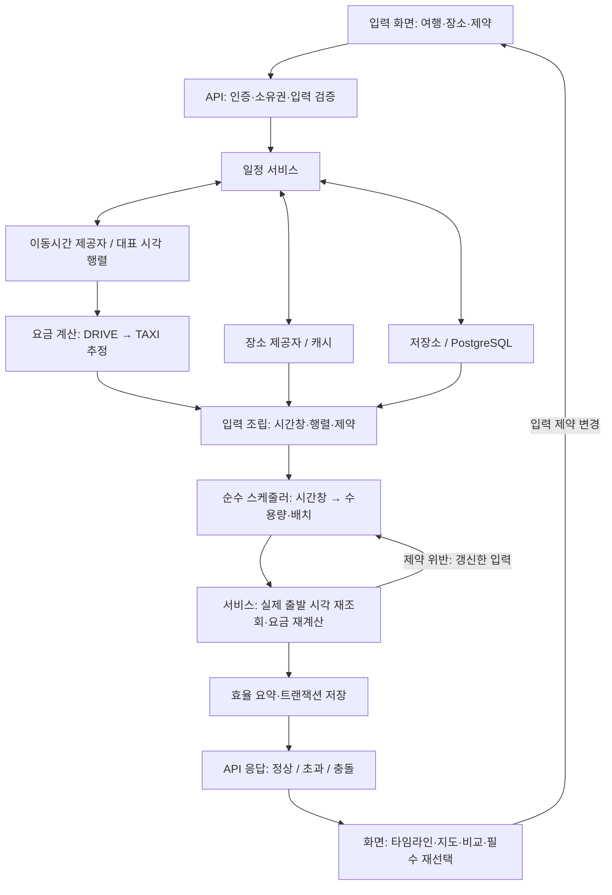

# 아키텍처

기준: 2026-11-19, T13A 시작 시 원격 `develop`의 `f0b4239`.
[요구사항](requirements.md)의 확정/추천/미정 구분은 그대로 유지한다.
T1–T13/T12B의 현재 연결과 T13A 정리를 기술한다. §7–8은 T7A 당시의 점검 기록이며,
현재 결과 UI와 전체 점검은 §9–10, 공유는 §11, 최종 점검(T15A, 기준 `ee500de`)은 §12를 따른다. 모바일 앱 전환 후 구조(T16 계획, T17 패키지 이동 완료)는 §13이다. 구조나 계약 변경은 관련 문서와 결정 기록을 함께 갱신한다.

## 1. 폴더 구조와 모듈 경계

```text
apps/server/                   @travel/server (Next.js, T25까지 기존 웹 화면도 유지)
  src/app/                     화면·서버 액션·인증/여행/장소/설정/동선/제약/공유 API
  src/components/, auth.ts     기존 웹 UI·Auth.js 구성
  src/lib/                     HTTP 정책, DB 풀, 마이그레이션 실행기, 인증
  src/{places,travel-time}/     제공자 포트·캐시·Google 어댑터·HTTP·조립
  src/{services,repositories}/ 서비스·SQL 저장소
  src/{itineraries,trips,settings,results,sharing}/ HTTP·조립·서버 포트와 core 재내보내기
  src/{scheduler,fare}/         기존 호출 지점용 core 재내보내기만 (계산 구현 없음)
  migrations/                  기존 001–006 SQL (내용·체크섬 유지)
  public/                      온라인 전용 sw.js·아이콘 (T25까지)
  scripts/                     migrate.ts, verify-pwa.mjs, benchmark-itinerary.ts
  tests/                       HTTP·SQL·웹 UI·구조 검사, Playwright
packages/core/                 @travel/core (플랫폼과 무관한 순수 로직)
  src/scheduler/               시간창·식사 슬롯·방문 배치·수단 선택·수용량
  src/fare/                    도시 프로필 타입·택시 요금 계산
  src/contracts/               trips/settings/results/itinerary/places/travel-time/sharing DTO·검증
  src/presentation/            결과 표시 변환·한국어 라벨
  tests/                       기존 scheduler·fare 순수 함수 검사
apps/mobile/                   @travel/mobile, T20 Expo·로그인·보호 라우트·API·보안 저장소
packages/design-tokens/         @travel/design-tokens, T20 플랫폼 독립 값·문서 일치 검사
docs/, scripts/agent/, .github/ 저장소 공통 문서·자동화 (루트 유지)
```

| 경계 | 책임과 허용 의존성 | 경계 밖의 일 |
|---|---|---|
| `apps/server/src/app`, `apps/server/src/auth.ts` | 세션 확인, 입력 검증, HTTP/화면 변환, 서버 서비스 호출 | 스케줄링 알고리즘, 브라우저에서 DB/비밀 키 접근 |
| 인증 코어 | [AuthStore](../apps/server/src/lib/auth/callbacks.ts)와 `authorizeTrip` 콜백에만 의존 | Google/SQL 구현을 콜백에 직접 결합 |
| `packages/core/src/scheduler` | 호출자가 제공한 시간창·행렬만 계산. 런타임 의존성은 내부 모듈과 Temporal | DB, fetch, 공급자 호출, 환경 변수, 현재 시각·난수 읽기 |
| `packages/core/src/fare` | 프로필·거리·주행시간·출발 instant·시간대에서 추정 요금 산출 | 요금표 조사, DB 조회, 환율 조회 |
| 일정 서비스 (T12) | 저장소/제공자 포트 주입, 좌표·영업시간 조회, 순수 함수 호출 순서, 재검증 | HTTP 객체를 코어에 전달, 고정 제약의 임의 해제, SQL |
| 제공자 | 외부 응답/단위 정규화, 캐시, 네트워크 실패 구분 | 정책에 맞는 이동수단 선택, 사용자 입력 변경 |
| 저장소 | SQL, 트랜잭션, 행→도메인 변환, 소유 데이터 연쇄 삭제 | 스케줄러 실행, 외부 API 호출 |

배치 계약의 `CityProfile`/시간창 참조는 **type import**다. 런타임에는
`index → capacity → placement → route-evaluation → transport`와
`index → placement/transport`가 연결된다. `placement-types.ts`의 타입 참조는 런타임 의존이 아니다. 전역 가변 캐시를 코어에 넣지 않는다.
`ReadonlyMap`/readonly 배열 입력을 바꾸지 않고 결과를 새로 반환한다.

현재 SQL 구현은 [auth/store.ts](../apps/server/src/lib/auth/store.ts)에 있다. 새 저장소는 같은 `pg` 풀을
주입받는 방식으로 추가하고 기존 인증 저장소 이동은 별도 작업에서 필요할 때 결정한다.
풀은 서버 프로세스에서 재사용하고 종료 시 닫는다. 빌드·모듈 import 시 연결하지 않는다.

## 2. 데이터 흐름

현재 연결된 실행 흐름은 `홈/서버 액션 → Auth.js → 인증 저장소 → PostgreSQL`,
`GET /api/trips/[id] → auth → authorizeTrip → tripOwner → { id }`,
`GET /api/places → auth → PlaceProvider → Google/좌표 캐시`,
`/trips/new → POST /api/trips → auth → parseTripDraft → tripInputRepository → PostgreSQL`,
`GET /api/city-profiles → auth → cityProfileRepository`,
`POST /api/trips/[id]/itinerary → auth → authorizeTrip → ItineraryService → 저장소·장소·이동시간 포트 → 스케줄러·요금 → 저장`이다.
T11 생활 설정은 `/trips/[id]/settings → GET/PUT /api/trips/[id]/settings → LivingSettingsService → LivingSettingsRepository`로 연결한다. 공용 계산은 기존 calculateDayWindow를 호출한다. 설정 저장 뒤 전체 동선은 T12 생성 API를 다시 호출해 계산하며, 화면 연결은 T13이다.

아래는 T8–T13의 전체 흐름이다(화면 부분은 T13). 화살표는 데이터 이동이며 호출 주체는 API의 서비스다.



1. 서버가 사용자와 여행 소유자를 확인한다. 클라이언트의 `ownerId`, 비용, 계산 결과는 신뢰하지 않는다.
2. 여행 기본값과 날짜별 덮어쓰기를 조합하고 장소 캐시의 유효성을 확인한다. 미완성 T2 여행은
   누락 필드를 알려 입력 완료를 요청한다. 임의 도시·시간대를 넣지 않는다.
3. 날짜별 대표 출발 instant로 방향성 이동 행렬을 조회한다(제공자 한도 100개를 넘으면 나눠 요청해 병합).
   공항↔숙소 경유·짐 처리 시간을 합산해 `calculateDayWindow`에 전달한다. 공항 이동은 일일 행렬 경로와
   중복 차감하지 않는다. 출국 이동이 체크인 마감 준수로 확인되지 않거나(`transferIssues`), 같은 날
   입국 완료가 출국 이동 시작 마감보다 늦으면(`flightConflicts`) 방문 유무와 무관하게 `CONFLICT`다.
4. DRIVE의 거리와 **주행시간**으로 택시 요금을 계산한 뒤 `RouteOptions.TAXI`로 바꾼다.
   호출 대기 버퍼는 `selectTravelMode`가 시간에 한 번 더한다. 모든 비교 비용은 같은 현지 통화다.
5. `checkCapacity`가 내부에서 `scheduleVisits`를 반복 실행한다. 단계 3의 판정은 단계 4–6의
   실제 배치 성공에 근거한다. 희망 장소는 고정한 경우에만 배치한다.
6. T12 서비스가 선택된 구간을 실제 출발 instant로 재조회하고 요금·영업시간·시간창을 다시 검사한다.
   위반 시 고정 제약을 유지한 입력으로 재배치한다. 시도 상한(`MAX_ROUTE_ATTEMPTS` = 8)과 같은
   미검증 구간 집합의 반복 탐지로 종료한다. 상한 근거와 루프 설계는 [ADR 0008 동선 생성](decisions/0008-itinerary-generation.md)에 있다.
   검증되지 않은 일정은 `CONFLICT`로 보고하며 `OK`로 저장하지 않는다.
7. 대중교통 기준과 정책 적용 결과의 이동시간·요금을 집계한다. 미상 요금은 0으로 합산하지 않는다.
   입력 해시와 결과를 함께 저장하고 API에서 JSON으로 직렬화한다.
8. 초과 시 원래 요청의 실패 진단, 검증된 추천 조합, 희망 장소를 구분해서 표시한다.
   선택 변경은 `REQUIRED`/`WISH` 및 고정 제약을 다시 저장하고 같은 파이프라인을 실행한다.

서비스가 I/O를 수행하며 스케줄러가 이동시간/요금 제공자를 호출하는 역방향 의존은 없다.
상세 판단 근거는 [ADR 0001](decisions/0001-pure-core-and-service-boundaries.md)에 있다.

## 3. 현재 핵심 인터페이스

실제 정의는 [scheduler/index.ts](../packages/core/src/scheduler/index.ts),
[placement.ts](../packages/core/src/scheduler/placement.ts), [capacity.ts](../packages/core/src/scheduler/capacity.ts),
[transport.ts](../packages/core/src/scheduler/transport.ts), [fare/index.ts](../packages/core/src/fare/index.ts)를 따른다.
이 문서의 TypeScript 블록은 한 모듈로 합쳐 실제 export와 함께 strict 타입 검사한다.

```typescript
import {
  calculateDayWindow, checkCapacity, scheduleVisits, selectTravelMode,
  type DayWindowInput, type DayWindowResult, type MealSlot, type MealWindows,
  type TimeWindow, type ScheduleInput, type ScheduleResult, type CapacityResult,
  type Visit, type TaxiPolicy, type RouteOptions,
} from '@travel/core/scheduler';
import { estimateTaxiFare, type CityProfile } from '@travel/core/fare';

export const schedulerContract: {
  calculateDayWindow(input: DayWindowInput): DayWindowResult;
  scheduleVisits(input: ScheduleInput): ScheduleResult;
  checkCapacity(input: ScheduleInput): CapacityResult;
  selectTravelMode: typeof selectTravelMode;
} = { calculateDayWindow, scheduleVisits, checkCapacity, selectTravelMode };

export interface FareProvider {
  estimateTaxiFare: typeof estimateTaxiFare;
}
export const fareProvider: FareProvider = { estimateTaxiFare };
```

| 입력/출력 | 계약 |
|---|---|
| `DayWindowInput` | 현지 `date`, IANA `timeZone`, 같은 날의 활동 `HH:mm` 구간, `mealCount` 0–3, 선택적 식사창·도착/출발 항공 제약. `travelMinutes`는 숙소 경유/짐 처리까지 포함한 전체 공항 이동시간 |
| `DayWindowResult` | `timeZone`, UTC instant 시간창 `available` 또는 null, `{slot, window|null}[]`, 공항 이동의 시간과 `viaLodging` |
| `ScheduleInput.days` | 날짜, 시간창 결과, 시작·종료 location ID, 방향성 `ReadonlyMap<from, ReadonlyMap<to, RouteOptions>>`, 날짜/방향별 수동 수단·짐 플래그 |
| `ScheduleInput.visits` | 고유 방문 ID, 장소 ID, 좌표, 체류 분, `REQUIRED/WISH`, 선택적 날짜·instant·0부터 세는 방문 순서 고정, 여행 전체의 영업 instant 창 |
| 나머지 `ScheduleInput` | 슬롯별 식사 소요 분, `NEVER/WHEN_NEEDED/PREFER`, 선택적 호출 버퍼·분당 추가비용 기준 |
| `RouteOptions` | `TRANSIT/WALK/TAXI`별 선택적 `{minutes, fare:number|null}`. 수단 없음은 경로 없음, `fare:null`은 요금만 미상. TAXI minutes에는 호출 대기가 아직 없음 |
| `ScheduleResult` | 날짜·IANA 시간대, `VISIT/MEAL` stops, 선택 수단·사용자 고정 여부·요금·instant가 있는 legs, 미배치 ID/사유/고정 여부, 날짜별 issues |
| `CapacityResult` | `OK/OVER_CAPACITY`이면 검증된 `recommendation`, `CONFLICT`이면 null. 원래 요청의 실패 `unplaced/issues`, 가용 분·체류/식사 분·이동/전체 필요시간 하한 |
| `CapacityRecommendation` | `requiredCount` N, `requiredVisitIds`, 실제 재배치한 `schedule`. 고정 필수는 N에 포함, 고정 희망은 제외. 최대해 보장은 아님 |
| `estimateTaxiFare` | `(CityProfile|null|undefined, distanceKm, durationMinutes, departure:Date, timeZone) → TaxiFareEstimate`. 출처·갱신일·통화·`estimated:true` 또는 `UNAVAILABLE/정보 없음` |

고정 순서는 식사를 제외한 방문 위치다. `openingHours` 생략은 미상, `[]`는 방문 불가다.
식사는 직전 위치에서 슬롯 시간을 확보하며 식당 방문과 자동 결합하지 않는다. 직접 고른
이동수단은 택시 정책보다 우선한다. 그 수단이 없으면 대체하지 않고 경로 없음으로 진단한다.
`CONFLICT`는 휴리스틱이 유효한 조합을 찾지 못했다는 뜻이지 불가능성의 수학적 증명이 아니다.
시간 하한만으로 수용 여부를 판단하지 않는다. 다른 N개 조합도 반드시 재검증한다.
[T7 인계](t7-handoff.md)의 추천 재현 방식은 유지한다.

## 4. 현재 제공자와 저장소 계약

장소와 이동시간 포트는 **T8/T9 구현**을 직접 참조하며 저장소는 **T10–T13 구현**을 따른다.
외부 SDK 타입, `pg` 행, Next.js `Request`를 이 경계 너머로 넘기지 않는다.

```typescript
// T8: 구현과 문서가 같은 계약을 사용한다. location은 캐시 가능한 좌표 조회다.
export type {
  PlaceProvider, PlaceSearchRequest, PlaceDetailsRequest, PlaceSummary, PlaceDetails, PlaceLocation,
} from '../apps/server/src/places';

export type {
  Money, Location, ProviderMode, TravelEstimate, TravelAlternatives,
  TravelRequest, MatrixRequest, RouteRequest, TravelMatrix, TravelTimeProvider,
} from '../apps/server/src/travel-time';
```

장소 검색은 한국어 요청이며 이름의 한국어 표기가 없는 경우를 허용한다. 내부 `Location.id`는
`places.id`, 방문 ID는 `trip_places.id`, 외부 조회 키는 `google_place_id`다. ID를 혼용하지 않는다.
영업정보 미상은 생략하고, 닫힌 날짜에는 빈 창을 반환한다. null 상세는 장소 없음이다.
외부 장애/쿼터 초과를 null 또는 빈 경로로 숨기지 않는다. DRIVE 요금은 null이며 택시 추정은
FareProvider가 맡는다. 대중교통 요금이 없으면 null을 유지한다.

T8 장소 캐시는 `google:v1:{googlePlaceId}:id,location` 키로 좌표만 기본 24시간 보관한다.
같은 프로세스의 유효 좌표 재조회는 외부 호출이 없고, 동시 요청도 한 번으로 합친다.
이름·유형·영업시간·검색 결과는 저장하지 않으며 상세 응답은 즉시 만료다. 따라서 전체 상세
반복 조회는 외부 호출이 발생한다. 최신 약관 근거, T8 완료 기준 해석의 차이와 저장소 계약
조정은 [ADR 0003](decisions/0003-places-cache-policy.md)에 기록했다. 장소 ID와 Google 상세의
수명을 분리하며 기존 places의 상세 열을 이 프록시에서 채우지 않는다.

API는 `GET /api/places?query=도쿄&regionCode=JP`,
`GET /api/places/{id}?timeZone=Asia/Tokyo&date=2026-11-23`(date 반복 가능),
`GET /api/places/{id}?fields=location`이다. 한국어만 요청하며 인증 전에는 제공자를 만들지 않는다.
응답은 `{places, attribution}` 또는 `{place, attribution}`이며 공급자 attribution도 전달한다.
세부 통합과 UI 표시 책임은 [T8 인계](t8-handoff.md)를 따른다.

T9 [이동시간 제공자](../apps/server/src/travel-time/index.ts)는 기존 matrix/route 계약을 구현한다.
`matrix`는 고유 장소 ID(최대 100개)의 방향성 행렬이며 대각선도 Google 응답을 따른다.
`GoogleTravelTimeProvider`는 `computeRouteMatrix`를 TRANSIT 10×10, WALK/DRIVE 25×25로
분할하고 응답 인덱스로 복원한다. 수단별 경로 없음은 해당 키 생략, 요금 없음은 null이다.
TRANSIT 요금의 units/nanos를 통화와 함께 숫자로 변환하고 WALK/DRIVE 요금은 null이다.
`route`는 행렬 응답 대신 `computeRoutes`를 사용한다. TRANSIT에 정확한 출발 instant를 전달하며
실시간 교통 제외 요구에 따라 DRIVE는 `TRAFFIC_UNAWARE`를 사용한다. WALK/DRIVE 외부 요청에는
출발 시각을 보내지 않는다. 서비스 요청에는 항상 IANA 시간대와 오프셋 있는 instant가 필요하다.
주행시간에 택시 호출 대기를 추가하지 않는다. 초→분, 미터→km 및 DRIVE→TAXI 변환은 T12 책임이다.

[캐시](../apps/server/src/travel-time/cache.ts)는 인스턴스별로 요청 종류/정규화한 instant/시간대/모드/방향/ID/좌표를
키에 담고, 명시적으로 TTL을 설정했을 때만 완료 응답을 보관한다(최대 24시간, 기본 32개 요청).
행렬 장소와 모드 순서만 정규화하며 시각·좌표를 반올림하지 않는다. 만료 타이머·용량 초과로
삭제하고 오류는 보관하지 않는다. 동시 요청은 합치되 반환 결과는 복제하며 dispose 후 재사용할 수 없다.
행렬과 구간 캐시는 서로 재사용하지 않아 재조회 의미를 보존한다.

Google 기본 [서버 팩터리](../apps/server/src/travel-time/server.ts)는 `GOOGLE_ROUTES_API_KEY`를 호출 시 읽고
완료 응답 캐시를 끈다. Google의 시간·거리·요금 보관 허용을 확인하지 못했기 때문이다.
같은 진행 중 요청만 합치고 완료 후 순차 반복에는 외부 호출이 있다. 따라서 T9의 반복 호출 0회
기준은 캐시 허용 제공자에 대해서만 자동 검증되며 Google 기본 연결에서는 **미충족/사람 확인 필요**다.
근거와 대안은 [ADR 0005](decisions/0005-travel-time-provider-and-cache.md), 통합 책임과 테스트는
[T9 인계](t9-handoff.md)에 기록했다. 장소 좌표 캐시 정책을 Routes 응답에 확대하지 않는다.
새 공개 HTTP 엔드포인트는 없으며 T12가 인증·소유권 검증 뒤 제공자를 생성한다.

```typescript
// T12: 일정 서비스의 포트와 데이터 계약. 구현과 문서가 같은 export를 사용한다.
export type {
  PlaceRef, TripInputs, TripLoad, ItineraryResult, LegComparison, EfficiencySummary, RouteAlternatives,
  ItineraryRepository, CityProfileSource, ItineraryPlaces, ItineraryDependencies, GenerateOutcome, SaveOutcome,
} from '../apps/server/src/services/itinerary';
export { ItineraryService, ItineraryInputError, MAX_ROUTE_ATTEMPTS, MEAL_MINUTES } from '../apps/server/src/services/itinerary';
```

위 저장소 계약은 서버 내부에서만 사용한다. [입력 스냅샷](../apps/server/src/repositories/trip-snapshot.ts)은
SQL time·JSONB·`WISHLIST`를 검증·변환하고 누락 필드를 `INCOMPLETE`로 돌려준다(초가 0이 아닌 시각도 포함).
행 순서를 고정해 같은 입력은 같은 SHA-256 `inputHash`를 갖는다. `TripInputs`의 장소는 `places.id`와
Google ID를 함께 갖는 `PlaceRef`이며 ownerId는 담지 않는다(소유권은 HTTP 처리기가 먼저 확인한다).
[일정 저장](../apps/server/src/repositories/itineraries.ts)은 `trips` 행을 `FOR UPDATE`로 잠근 뒤 같은 트랜잭션에서
입력 해시를 다시 계산하고, 다르면 아무것도 쓰지 않고 `STALE`을 반환한다. T11 [생활 설정 저장소](../apps/server/src/repositories/living-settings.ts)도
같은 `trips` 행을 `FOR UPDATE`로 잠그므로 설정 수정과 일정 저장이 직렬화된다. 상세는 [ADR 0008 동선 생성](decisions/0008-itinerary-generation.md).
T7A의 전체 상세 PlaceRepository 계약은 ADR 0003에 따라 철회했다. 장소 ID 영구 저장은 T10 생성 저장소에서 연결한다.

T10 현재 생성 DTO·한도·기본값·프로필 추천은 [ADR 0006](decisions/0006-trip-input-creation.md)에 기록한다.
[TripDraft 검증기](../apps/server/src/trips/input.ts)는 클라이언트 단계 검사와 서버 전체 검사에 공용이며,
[HTTP 처리기](../apps/server/src/trips/http.ts)는 인증·JSON·동일 출처·필드 오류를 확인한다.
[여행 생성 저장소](../apps/server/src/repositories/trip-inputs.ts)는 세션 ownerId만 받아 트랜잭션으로 저장한다.
[프로필 저장소](../apps/server/src/repositories/city-profiles.ts)는 SQL numeric/time/JSONB를 정규화한다.
이 생성 계약과 별개로 loadInputs/saveItinerary는 T12 저장소가 구현하며, 기존 여행 수정(saveInputs)은 T11 범위다.
UI는 Google Maps와 제공자 attribution을 표시하며 외부 링크는 http/https만 허용한다.
입력 이름과 검색 결과는 화면 메모리에만 존재한다. 새로고침 시 미저장 입력 복구는 제공하지 않는다.

### T11 생활 설정 계약

[ADR 0007](decisions/0007-living-settings.md)에 설정 상속·동시 편집·재계산 범위를 기록한다.
[타입](../apps/server/src/settings/model.ts)의 `LivingSettings`는 기본 시각·식사 슬롯/시간대·택시 정책과
날짜별 nullable 덮어쓰기다. `GET/PUT /api/trips/[id]/settings`는 세션 소유권을 확인한다.
PUT은 `{ revision, settings }`, 응답은 `{ snapshot, calculation }`이다.
[서비스](../apps/server/src/settings/service.ts)는 [공유 검증](../apps/server/src/settings/input.ts)과
[계산](../apps/server/src/settings/calculate.ts)을 호출하고 [저장소](../apps/server/src/repositories/living-settings.ts)가
여행 행 잠금 뒤 소유권·revision을 다시 검사해 기본값/날짜별 행만 원자적으로 저장한다.
기존 고정 방문과 결과는 수정하지 않는다. 읽기는 repeatable read 스냅샷이다.
날짜별 0끼와 null 상속은 구별하며 기존 날짜 행의 created_at은 유지한다.

`calculation.scope = TIME_WINDOWS`: 활동/식사창과 항공 버퍼, 고정 시각·체류시간의
시간창 충돌만 검사한다. 공항 이동은 0분으로 두며 실제 이동·영업시간·고정 순서·수단·식사
배치와 택시 정책별 경로 재선택은 이 미리보기에 포함되지 않는다. T13에서는 저장 후
T12 생성 API를 호출해 전체 동선도 검증하며, 화면에서 두 검증의 범위를 구분한다(§9).
서버 저장 실패 시 UI는 초안을 보존하고 재시도한다. 변경된 입력은 409로 거부하며 사용자가
명시적으로 다시 불러온다. 전체 itinerary input_hash는 이 설정 revision과 별도로 계산해야 한다.
검증/후속 연결은 [T11 인계](t11-handoff.md)에 기록한다.

## 5. 저장 형식·시간대 변환

결정 근거: [ADR 0002](decisions/0002-time-storage-and-error-contracts.md),
[ADR 0004](decisions/0004-database-migrations-and-timestamps.md).
스키마 원본은 [001](../apps/server/migrations/001_auth.sql), [002](../apps/server/migrations/002_travel_model.sql),
[003](../apps/server/migrations/003_city_profile_night_hours.sql), [004](../apps/server/migrations/004_database_foundations.sql) 순서다.
`DATABASE_URL`을 설정하고 `npm run migrate`로 준비한다. [실행기](../apps/server/src/lib/migrations.ts)는
`schema_migrations(version, checksum, applied_at, origin)`과 SQL 파일의 SHA-256을 대조하여
미적용 파일만 순서대로 실행한다. 이력 없는 기존 DB는 001/001–002/001–003 중 어느 스키마인지
검증용 임시 스키마의 열·타입·기본값·제약조건과 비교해 기존 이력을 등록한다. 임시 스키마는
롤백하고 사용자 데이터는 그대로 둔다. 부분 적용·불일치 상태는 실패시키며 이력을 추측하지 않는다.
이관 시 DB `CREATE` 권한과 앱 쓰기 중지가 필요하다. 정상 이력 이후에는 임시 스키마가 필요 없다.
현재 스키마에 대한 트랜잭션 advisory lock으로 동시 실행을 직렬화하고, 한 실행의 모든 SQL과
이력을 함께 커밋하거나 롤백한다. SQL 파일 자체에 트랜잭션 제어를 넣지 않는다.
테스트와 CI는 동일 실행기로 격리 스키마를 준비하며 [통합 테스트](../apps/server/tests/migrations.test.ts)는 CLI도 실행한다.

모든 사용자 소유 테이블(`users`, `trips`, `day_settings`, `flights`, `lodgings`, `trip_places`,
`itineraries`, `day_plans`, `stops`, `legs`)에 `created_at/updated_at timestamptz NOT NULL DEFAULT now()`가 있다.
사용자의 기존 생성 시각은 유지하고, 과거 시각이 없는 행은 이관 시각으로 채운다. 사용자 소유 테이블과
공유 `places`의 `updated_at`은 `BEFORE UPDATE` 트리거가 `statement_timestamp()`로 갱신한다.
동일 값 UPDATE와 UPSERT도 갱신하며 자식 수정이 부모 시각을 바꾸지는 않는다. 따라서 `trips.updated_at`만으로
입력 버전이나 stale 여부를 판단하지 않는다. `city_profiles.updated_at`은 요금 출처의 갱신일로 계속 호출자가 관리한다.
모든 FK 열은 기존 PK/UNIQUE 또는 새 인덱스의 첫 열로 포함되며 [카탈로그 검사](../apps/server/tests/database-foundations.test.ts)가 검증한다.

최신 일정은 `itineraries.generation bigint GENERATED ALWAYS AS IDENTITY`의 가장 큰 값이다.
`SELECT ... FROM itineraries WHERE trip_id = $1 ORDER BY generation DESC LIMIT 1`을 사용하며
`(trip_id, generation DESC)` 고유 인덱스로 지원한다. 생성 시각이 같아도 INSERT 순서를 구별하고
과거 결과·하위 행을 지우지 않는다. 기존 행의 번호는 과거 생성 순서 복원이 아니며, 새 결과부터 순서가 보장된다.
이는 INSERT 순서이지 트랜잭션 커밋 순서가 아니다. T12는 같은 여행의 저장을 잠금으로 직렬화하고
입력 해시 재검증을 함께 구현해야 한다. 생성 번호는 입력 버전이나 일정의 정상 상태를 뜻하지 않는다.

| DB/외부 표현 | 코어 입력으로 변환하는 책임 |
|---|---|
| `date`, `time`, `flights.local_datetime` (timestamp without time zone) | 저장소는 현지 달력 문자열로 읽는다. 호스트 로컬 `Date`로 재해석하지 않는다. 서비스가 Trip의 IANA 시간대로 instant 변환 |
| `timestamptz`, `updated_at`, `cache_expires_at` | 오프셋 있는 ISO instant. 요금 함수에만 `Date`로 전달 |
| PostgreSQL numeric | 저장소에서 유한·비음수 숫자로 검증. `pg`의 기본 numeric 문자열을 그대로 산술에 쓰지 않음 |
| PostgreSQL time `22:00:00` | 분 단위 설정은 `22:00`으로 정규화. 초가 0이 아니면 조용히 자르지 않고 입력 오류 |
| DB 우선순위 `WISHLIST` | 코어 `WISH`로 양방향 명시 변환. SQL enum을 바로 `Visit`로 단언하지 않음 |
| `fixed_date` + `fixed_time` | 여행 시간대에서 `fixedStart` instant로 변환. 날짜 없이 시각만 저장된 행은 입력 보완 필요 |
| 날짜별 null 설정 | 여행 기본값 상속. `meal_slots: []`는 끼니 없음이며 null과 다름 |
| `meal_slots`, `meal_windows` JSONB | 슬롯 집합과 `{start,end}` 검증. 현재 SQL 테스트의 `["11:30","14:00"]` 형태도 변환 필요 |
| 슬롯 집합 → T5의 `mealCount` | `[]/[LUNCH]/[LUNCH,DINNER]/[BREAKFAST,LUNCH,DINNER]`만 수로 직접 변환 가능. `[DINNER]` 등을 길이만 세어 점심으로 바꾸지 않음. 변환 규칙은 scheduler의 `mealCountForSlots` 하나이며 T11 `countForSlots`(거부 시 RangeError)와 T12 일정 생성(필드 오류)이 함께 쓴다. 임의 조합은 거부 |
| `stops`/`legs` SQL | T12의 [005](../apps/server/migrations/005_itinerary_details.sql)가 stop 종류·식사 슬롯, leg 양 끝점·출발/도착 instant·요금, 일정 `details` JSONB를 추가. 사용자 구간 이동수단 고정 입력은 T13에서 보완 |

시간은 여행의 IANA 시간대를 항상 함께 전달한다. 현지 입력은 `Temporal`의
`disambiguation: 'reject'`로 변환해 DST에서 존재하지 않거나 두 번 나타나는 시각을 거부한다.
고정 시작·영업시간·행렬 출발은 오프셋 있는 instant다. 산술과 수용량은 실제 경과시간 기준이며
하루를 무조건 24시간으로 계산하지 않는다. 활동/식사창은 같은 현지 날짜의 `[start,end)`로,
자정을 넘기는 활동창은 현재 지원하지 않는다. 종료 시각에 딱 맞게 끝나는 방문/이동은 허용한다.

기본 항공 버퍼는 입국 90분, 출국 150분이다. 가용 시간 교집합이 없으면 null로 반환한다.
공항 이동시간과 버퍼는 비음수 정수 분, 방문/경로 시간은 비음수 유한 분이며 배치 시 ms로
올림한다. 요금의 심야 구간은 현지 출발 시각에서 시작 포함/끝 제외로 평가하고 자정 통과를 지원한다.
화면은 원래 시간대로 다시 표시한다. 시스템 시간대를 도쿄나 서울로 가정하지 않는다.

사용자 삭제는 `users → trips → day_settings/flights/lodgings/trip_places/itineraries →
day_plans → stops/legs`의 FK cascade로 실행한다. 공유 장소 캐시와 도시 프로필은 사용자
소유 데이터가 아니므로 남는다. 세션은 매 요청 사용자 존재 여부를 확인한다.

## 6. 오류 처리와 API 경계

| 상황 | 현재 동작 | 후속 API 처리 계약 |
|---|---|---|
| 로그인 없음/타인 소유/여행 없음 | `authorizeTrip`: 401/403/404. 현재 GET은 공통 한국어 오류 메시지 | 같은 상태 유지, 서버 액션도 소유권 확인 |
| 잘못된 시각·기간·숫자/중복 방문 ID | 순수 함수에서 `RangeError` 등 발생. T10 생성 입력은 공유 검증기로 400 + 필드 오류 반환 | 입력 검증 단계에서 400 + 필드별 오류. 모든 내부 예외를 400으로 일괄 변환하지 않음 |
| 여행 입력 미완성/계산 중 변경 | T12: 누락 필드·일정으로 만들 수 없는 입력은 409 + `fields`, 저장 시 입력 변경은 409 재생성 안내 | 같은 상태 유지 |
| `OK/OVER_CAPACITY/CONFLICT` | 정상적인 도메인 결과. `OVER_CAPACITY`에도 유효 추천 있음 | 계산 요청의 200 응답 본문에 상태를 유지. 고정 충돌을 임의 수정하지 않음 |
| `unplaced.TIME_WINDOW/UNREACHABLE/FIXED_ORDER` | 방문 ID에 연결된 실패 원인. `WISH`는 오류가 아닌 의도적 미배치 | 원래 실패와 추천에서 제외된 목록을 구분 |
| `issues.MEAL_UNAVAILABLE/UNREACHABLE/TIME_WINDOW` | 식사 슬롯/연결 실패/일일 경로의 시간창 실패. 마지막 것은 T7A 추가 | 날짜별 진단으로 표시. 방문 없는 숙소 이동 초과도 `CONFLICT` |
| 요금 없음 | null 또는 `TaxiFareEstimate.UNAVAILABLE` | 이동 가능 여부와 분리하고 정보 없음 표시 |
| 외부 API 장애·쿼터/DB 장애 | T8: 제공자 실패 503, 잘못된 외부 응답 502, 내부 실패 500. T9: TravelProviderError의 UNAVAILABLE/INVALID_RESPONSE. T12 동선 생성: 장소·이동시간 장애를 503/502, 입력 오류를 400, 내부 오류를 500으로 변환 | 비밀 값·SQL·공급자 원문을 응답에 노출하지 않음 |

가용 시간도 없고 시작/종료가 같은 빈 날은 이동이 필요 없어 빈 일정이 가능하다.
시작/종료가 다르면 이동을 생략해 성공으로 처리할 수 없다. 진단은 해당 휴리스틱 시도의
실패이며 최소 충돌 집합을 보장하지 않는다. T9의 TravelInputError는 입력 오류이며
TravelProviderError는 외부 장애다. 누락·중복 행렬 요소, 잘못된 단위/요금은 INVALID_RESPONSE,
HTTP/네트워크/행렬 요소의 nonzero status는 UNAVAILABLE로 실패한다. 부분 성공을 반환하지 않는다.
T12는 캐시 만료/네트워크 실패를 영업 종료나 이동 불가와 섞지 않는다.

## 7. T1–T7 코드와 문서 차이 점검

전체 T1–T7 소스·마이그레이션·기존 테스트를 기준으로 점검했다. 아래의 후속 항목은
새 요구사항이나 T7A 완료 구현으로 간주하지 않는다. README는 T1 시점 설명이 남아 있으므로
아래 현재 상태와 소스 링크가 기술 구조의 기준이다.

| 작업 | 코드/문서 차이 또는 결함 | T7A 처리와 후속 담당 | 검증 |
|---|---|---|---|
| T1 | README의 정적 홈·T2/T3 예정 설명은 현재 인증/스키마와 다름. DB 테스트가 읽기 전용이라는 설명도 오래됨 | 현재 구조를 이 문서와 README에 정정. 테스트는 격리 스키마를 만들고 지움 | [PWA](../apps/server/tests/pwa.test.ts), [SW](../apps/server/tests/service-worker.test.ts), [DB](../apps/server/tests/db.test.ts) |
| T2 | 다른 사용자 403은 순수 권한 함수 검사. 실제 Google OAuth 브라우저 흐름은 미검증 | 현재 보장 범위를 명시. 실제 로그인·로그아웃은 사람 확인 | [인증](../apps/server/tests/auth.test.ts) |
| T2/T3 | 탈퇴 SQL 테스트에서 flights/lodgings/trip_places/stops 삭제 검증 누락 | 해당 행을 생성하고 모든 소유 테이블 삭제·공유 places 보존을 검사하도록 보강 | [여행 모델](../apps/server/tests/travel-model.test.ts) |
| T3 | 스키마/SQL 테스트는 있고 여행 저장소·생성/수정 API는 없음. GET은 `{id}`만 반환 | 후속 저장소 계약 정의, T10/T12 구현. 기존 T2 nullable 여행도 명시적으로 처리 | [SQL 모델](../apps/server/tests/travel-model.test.ts), 문서 계약 타입 검사 |
| T3/T5/T6 | `WISHLIST/WISH`, 슬롯 집합/mealCount, 현지 time/instant, JSONB 창 모양 불일치. 아직 연결하는 코드 없음 | §5에 명시적 변환과 미완성 입력 처리 규칙 기록. T10–T12 연결 때 회귀 테스트 추가 | [SQL 모델](../apps/server/tests/travel-model.test.ts), [T5](../packages/core/tests/scheduler.test.ts), [T6](../packages/core/tests/scheduler-placement.test.ts) |
| T3/T12/T13 | stop 종류·식사 슬롯, leg 시각/끝점, 사용자 구간 고정 입력, 추천 상세 저장 필드 부족 | 현재 저장 성공으로 주장하지 않음. T12/T13 스키마 보완 범위로 인계 | 스키마 대조, 문서 계약 타입 검사 |
| T4 | 순수 추정/프로필 스키마만 존재. 실제 10개 도시/환율/저장소 없음. SQL numeric/time과 요금 입력 표현이 다름 | 변환 규칙 기록. 실제 요금표 T4D, 제공자 연결·환율/효율 요약 T12에서 구현 | [요금](../packages/core/tests/fare.test.ts), [심야 SQL](../apps/server/tests/travel-model.test.ts) |
| T5 | 식사 결과는 예약 시간창이며 식당과 자동 결합하지 않음. 공항 이동은 호출자가 합산 | 기존 가정을 명시하고 T12 입력 조립 책임으로 유지 | [시간창](../packages/core/tests/scheduler.test.ts) |
| T6 | 대표 시각 행렬만 사용, 실제 출발 시각 재조회·구간 대안·전체 효율 없음 | T9/T12로 인계. 순수 계산에서 외부 호출 금지 | [배치](../packages/core/tests/scheduler-placement.test.ts), 의존 경계 검사 |
| T6/T7 | 방문 없는 날의 숙소 간 이동이 시간창보다 길어도 실패 진단이 없어 `OK` 추천 | **결함 수정**: 최종 경로 시간창 실패를 issues에 전달. 창이 없는 필수 이동도 충돌. 정확한 경계/경유 성공은 유지 | [수용량](../packages/core/tests/scheduler-capacity.test.ts)의 `overlong daily transfer`, `no available window` 회귀 |
| T7 | “최대 N”은 최적해가 아닌 검증된 휴리스틱 조합. 시간 합은 하한이며 CONFLICT는 탐색 실패 | 구현 변경 없이 의미를 보존하고 API/화면 계약에 명시 | [수용량](../packages/core/tests/scheduler-capacity.test.ts)의 재현·같은 N 재선택·성능·입력 불변성 |

폴더 이동, 코어 추상화 재작성, 신규 API/DB 열/패키지 추가는 수행하지 않았다.
이슈 없는 구현을 설계 문서에 맞추기 위한 리팩터링도 하지 않았다.

## 8. 검증과 다음 작업

| T7A 완료 항목 | 자동 검사와 근거 |
|---|---|
| 구조·경계·흐름·핵심 인터페이스·시간대·오류 문서 | [architecture.test.ts](../apps/server/tests/architecture.test.ts): 문서 구성/실제 소스·테스트·ADR 링크, TypeScript 계약 블록 strict 검사, 코어 의존 경계 |
| 차이 목록과 결함만 수정 | §7에 T1–T7 추적, 수용량 회귀 테스트와 전체 소유 데이터 삭제 SQL 검사. 범위는 diff로도 확인 |
| 주요 결정 기록 | ADR 0001/0002 링크 및 결정·이유·대안의 문서 검사 |
| 기존 동작 보존 | `npm run lint`, `npm run typecheck`, `npm run build`, `npm test` |

Node 24와 PostgreSQL 16을 사용한다. `npm test`는 빌드 이후 실행하고 DB는 환경 변수
`DATABASE_URL`로 받는다. DB 테스트는 연결이 없어도 skip하지 않는다. 실제 API 키 없이
목/픽스처로 테스트하며 외부 연동 확인과 실제 도시 데이터 검토는 사람이 수행한다.
실행 결과·환경 한계·다음 작업 체크포인트는 [T7A 인계](t7a-handoff.md)에 남긴다.

## 9. T13 결과 UI와 제약 저장

이 절은 T11/T12에서 후속 연결로 남겼던 결과 화면·전체 재계산·구간 수동 지정의 현재 구현을 보완한다.

- `/trips/[id]/result`와 [결과 컴포넌트](../apps/server/src/components/itinerary/index.tsx)가 지도/타임라인/비교/초과 선택을 연결한다.
- [공유 DTO](../apps/server/src/results/model.ts), [검증](../apps/server/src/results/input.ts), [표시 변환](../apps/server/src/results/presentation.ts)은 브라우저/서버 공용이며 DB·네트워크에 의존하지 않는다.
- [결과 서비스](../apps/server/src/services/itinerary/editing.ts)는 ConstraintRepository와 장소 제공자 포트만 사용한다. [HTTP](../apps/server/src/results/http.ts)가 인증·소유권·동일 출처·오류를 처리하고 server.ts가 구체 구현을 조립한다.
- [저장소](../apps/server/src/repositories/itinerary-constraints.ts)는 여행 행 잠금 아래 소유권과 전체 입력 해시를 재검사하고 방문/수단 제약을 원자적으로 저장한다.
- GET `/api/trips/[id]/constraints`는 `{ input, revision, places }`, PUT은 `{ revision, constraints: { visits, legModes } }`를 받고 `{ input, revision }`을 반환한다. revision은 동선 입력 해시다. 누락/중복/다른 여행 ID·기간 밖 날짜·DST 모호 시각을 거부한다.
- 방문 제약은 기존 trip_places에, 구간 제약은 [006](../apps/server/migrations/006_itinerary_constraints.sql)의 trips.leg_modes에 저장한다. 후자는 날짜·출발/도착 장소 ID·수동 수단 배열이다. 장소 이름/귀속 정보는 실시간 응답에만 포함한다.
- [일상 구간 적용](../apps/server/src/services/itinerary/constraints.ts)은 기존 짐 속성을 유지하고, 공항 이동은 기존 transfer 선택에 fixedMode를 전달한다. 입력 해시에 수단 제약도 포함된다.
- PUT 성공 뒤 기존 POST `/api/trips/[id]/itinerary`로 재검증한다. POST 응답에 inputHash를 추가해 다른 입력으로 생성된 결과 표시를 막는다. 생성 실패 시 저장한 제약은 유지된다. 화면 재접속은 입력을 복원하고 버튼으로 재생성한다.
- 생활 설정 저장 뒤 [전체 검증](../apps/server/src/components/living-settings/itinerary-preview.tsx)도 기존 POST를 호출한다. 입력 중 TIME_WINDOWS 미리보기는 전체 검증과 구분한다.
- [지도 어댑터](../apps/server/src/components/itinerary/google-map.ts)는 브라우저 전용 Maps 키/지도 ID로 고급 마커를 표시한다. 지도 로딩 실패에도 장소 목록에서 편집할 수 있다.

이 결정의 이유·대안·검증은 [T13 ADR](decisions/T13-result-ui-and-constraints.md)에 기록한다. T12B의 날짜별 짐 처리 모듈은 변경하지 않는다.

## 10. T13A 전체 점검과 성능

[전체 점검 목록](t13a-audit.md)에 책임 혼합·중복·순환/경계·변경 지점·불필요 코드와
시작 시 300줄 초과 파일을 모두 기록했다. 동작 보존 정리의 이유와 대안은
[T13A 결정](decisions/T13A-audit-and-fare-preparation.md)을 따른다.

- `scheduler/placement-types.ts`는 타입, `route-evaluation.ts`는 단일 경로 평가,
  `placement.ts`는 배치/개선 탐색이다. `scheduler/index.ts`와 `placement.ts`의 기존 export를 유지한다.
- `fare.createTaxiFareEstimator(profile, departure, timeZone)`는 동일 출발 시각의 요금 준비를
  최초 사용 시 한 번 수행하고, 매 구간의 거리·시간 검증과 금액 계산은 계속 수행한다.
  `FareConverter.table`은 행렬 내에서만 재사용하며 실제 출발 시각 route는 별도 준비한다.
  기존 `estimateTaxiFare` 시그니처/오류/금액은 유지하며 프로세스 전역 상태는 추가하지 않는다.
- `LivingSettingsStore`는 소비자인 `settings/model.ts`에 두고 구현체는 repositories가 제공한다.
  저장소 모듈의 기존 타입 export도 유지해 호출 지점의 호환성을 보존한다.
- `lib/http.ts`는 캐시 금지 JSON과 Origin 비교만 공유한다. 기존 endpoint별 입력 크기,
  Content-Type/Sec-Fetch-Site 검사, 인증 순서와 400/401/403/404/409/500 계약은 바꾸지 않는다.
- 구조 검사: [계층](../apps/server/tests/architecture-layers.test.ts), [전체 소스 의존 그래프](../apps/server/tests/helpers/source-graph.ts).
  클라이언트 코드의 전이 의존까지 검사하되 타입 import와 공개 빌드 상수 `NODE_ENV`는 구별한다.
- 성능 회귀: [요금 행렬](../apps/server/tests/fare-matrix.test.ts). 시간 비율 대신 행렬별 준비 1회와
  단일 변환 동등성을 검사한다. [오프라인 벤치마크](../apps/server/scripts/benchmark-itinerary.ts)의 전후 중앙값과
  전체 결과 해시는 점검 문서에 남긴다. Google/DB 네트워크 지연을 측정한 결과는 아니다.

HTTP/DB 스키마·수단 선택·추천 탐색·공항 직행일 짐 처리의 기존 동작은 유지한다.

## 11. T14 읽기 전용 공유

- 소유자 POST `/api/trips/[id]/share`는 `{ path: "/share/{token}" }`를 반환한다.
  세션·여행 소유권·동일 출처를 검사하며 재발급은 이전 링크를 무효화한다.
- 공개 GET `/api/share/[token]` → [SharingService](../apps/server/src/services/sharing.ts) →
  [ShareRepository](../apps/server/src/sharing/model.ts) → [SQL 구현](../apps/server/src/repositories/sharing.ts).
  `load`는 입력 스냅샷·결과, 미준비 `UNAVAILABLE`, 잘못된 토큰 `null`을 구분한다.
  표시 입력 축소와 장소 참조 목록은 서비스가 계산한다(T15A).
- 기존 `trips.share_token`에 256비트 난수 토큰의 SHA-256 해시를 저장한다. 스키마 변경은 없다.
  재발급 UPDATE도 owner_id를 검사하고, 장소 조회 후 유효성을 재확인한다.
- [결과 읽기](../apps/server/src/repositories/shared-itinerary.ts)는 itineraries/day_plans/stops/legs를
  고정 개수 쿼리로 복원한다. REPEATABLE READ 트랜잭션 안에서 입력 해시를 비교하고
  최신 generation만 선택한다. 이전 결과·현재 입력 혼합은 409로 거부한다.
- [표시 정보 조회](../apps/server/src/services/itinerary/display-places.ts)는 편집·공유 서비스에서 재사용하며
  Google 장소 ID별로 중복 요청을 제거한다. 이름·귀속 정보의 영속 저장은 추가하지 않는다.
- 공개 응답은 `SharedItinerary`의 표시용 `ResultDisplayView`와 계산 결과만 포함한다.
  원본 여행 설정·사용자 정보·revision은 제외한다. 공유 화면은 편집 콜백 없이 기존
  지도·타임라인·효율 표시를 사용하며 기존 수정 API의 인증 계약은 유지한다.
- 잘못된/폐기된 토큰 404, 결과 없음/오래된 입력 409, 외부 장애 502/503, 내부 오류 500.
  API는 private/no-store 및 검색·referrer 차단 헤더, 페이지는 동적 렌더링·동일 메타 정책을 사용한다.
- 검증·대안·제약은 [T14 결정](decisions/T14-read-only-sharing.md)에 기록한다.

## 12. T15A 최종 전체 점검

[최종 점검 목록](t15a-audit.md)에 T13A와 같은 체크리스트·300줄 초과 파일·남은 문제를 기록했다.
이유와 대안은 [T15A 결정](decisions/T15A-final-audit.md)을 따른다. 공개 API·스키마·화면 동작은 바꾸지 않았다.

- [details 형식](../apps/server/src/repositories/itinerary-details.ts)이 `itineraries.details` JSONB의 타입·인코더·레거시 판정을
  한 곳에서 정의한다. 일정 저장과 공유 결과 읽기가 함께 사용한다.
- `ShareRepository.load`는 `TripInputs`와 결과를 돌려준다. [공유 서비스](../apps/server/src/services/sharing.ts)가
  `displayInput`으로 공개 입력을 줄이고 `tripPlaceRefs`(편집 서비스와 공용)로 장소 참조를 만든다.
- `lib/http.isCrossSiteRequest`는 설정·공유 쓰기가 이미 하던 Origin + `Sec-Fetch-Site` 검사를 합친 것이다.
  나머지 쓰기 경계의 정책 통일은 [질문](questions.md)의 사람 결정 항목이다.
- [여행 생성](../apps/server/src/repositories/trip-inputs.ts)은 자식 테이블당 INSERT 1회다. 장소 upsert는 잠금 순서를 위해 정렬된 행별 실행을 유지한다.

## 13. T16 앱 전환 후 구조 (계획)

기준: T16 설계 `3c9cb12`, T17 시작 원격 `develop` `9512b21`. §13.1의 패키지 이동은 T17에서 구현했다. §13.2의 오류 `code`와 §13.3의 모바일 세션·Bearer 인증은 T18에서 구현했다([T18 결정](decisions/T18-mobile-session-tokens.md)). T19 경로 모양 API, T20 앱 골격·토큰·로그인, T21 여행 입력, T22 결과 화면(§13.4.3, §13.5), T23 필수 선택까지 구현했다. T24–T25 화면은 아래 계획을 따른다.
§1–12는 현재 구현 설명으로 유지하고, 해당 작업이 끝나면 그 작업이 본문을 갱신한다.
결정 이유와 대안은 [T16 결정](decisions/T16-app-transition.md), 구현 세부는 [T17 결정](decisions/T17-npm-workspaces.md)에 있다. 아래 `ts` 블록은 계획 단계의 계약이라 타입 검사하지 않으며,
구현하는 작업이 실제 export와 함께 `typescript` 블록으로 바꾼다.

### 13.1 모노레포 폴더 구조와 패키지 책임

npm workspaces(`"workspaces": ["apps/*", "packages/*"]`). 루트 `lint`·`typecheck`·`build`·`test`·`migrate`는
`npm run <script> --workspaces --if-present`로 모든 패키지를 실행한다(CI 워크플로 수정 없음).

```text
apps/
  server/                  @travel/server. Next.js API·공유 페이지·기존 웹 화면(T25까지)
    src/app/api/           기존 API, session·account(T18 구현), itinerary/shapes(T19)는 후속
    src/app/share/         공유 열람 페이지
    src/{lib,places,travel-time,services,repositories,itineraries,trips,settings,results,sharing,sessions}/
                           HTTP·서비스·저장소·제공자·조립, 서버 포트 유지
    migrations/, scripts/, tests/   기존 SQL·실행기·서버 테스트
  mobile/                  @travel/mobile. T20 Expo SDK 58 앱
    app/                   expo-router 화면 라우트
    src/{api,auth,theme,components,screens,navigation}/  T22: map(지도 계약·순수 계산·어댑터), result(결과 순수 모델)
    assets/fonts/, tests/  Pretendard·jest-expo 컴포넌트 검사
packages/
  core/                    @travel/core
    src/scheduler/         순수 일정 계산
    src/fare/              순수 요금 계산
    src/contracts/         공용 DTO·오류 클래스·입력 검증·설정 계산
    src/presentation/      결과 표시 변환
    tests/                 scheduler·fare 검사
  design-tokens/           @travel/design-tokens. T20 src/index.ts·문서 일치 검사
```

| 패키지 | 책임 | 의존해도 되는 것 | 의존하면 안 되는 것 |
|---|---|---|---|
| `packages/design-tokens` | 디자인 값(hex 문자열, pt 숫자, ms, 이징 계수). 플랫폼 변환 없음 | 없음 | 다른 모든 패키지, React, React Native, CSS |
| `packages/core` | scheduler·fare 순수 계산, 공용 DTO·입력 검증·표시 변환 | `@js-temporal/polyfill` | Node 내장 모듈(`node:*`), `pg`, `fetch`·환경 변수, React, React Native, Next, `apps/*` |
| `apps/server` | HTTP 계약·인증·소유권, 서비스·저장소·Google 어댑터, 공유 열람 페이지 | core, design-tokens(공유 페이지), `next`, `pg`, `jose`, T25 전까지 `next-auth` | `apps/mobile`, React Native |
| `apps/mobile` | 화면, API 클라이언트, 세션 보관, 지도 어댑터 | core, design-tokens, `expo`·`react-native`·`react-native-maps`·`expo-secure-store`·네이티브 Google 로그인 | `apps/server`(타입 포함), `pg`, Google 서버 키, 웹 화면 코드(`apps/server/src/components`) |

T17에서 옮긴 공용 코드(아래 서버 경로는 호환용 재내보내기와 서버 포트를 유지):

| 서버 호환 경로 | core로 이동한 것 | 서버에 남는 것 |
|---|---|---|
| `apps/server/src/scheduler/`, `apps/server/src/fare/` | 전부 | 없음 |
| `apps/server/src/trips/input.ts` | `TripDraft`, `parseTripDraft`, `TripInputError` | 없음 (`http.ts`·`server.ts`는 서버) |
| `apps/server/src/settings/input.ts`, `calculate.ts`, `model.ts` | 검증, 시간창 계산, `LivingSettings`·`SettingsView` 등 DTO, `SettingsError` | `LivingSettingsStore` 포트, `service.ts`·`http.ts`·`server.ts` |
| `apps/server/src/results/model.ts`, `input.ts`, `presentation.ts` | 전부 | `http.ts`·`server.ts` |
| `apps/server/src/sharing/model.ts` | `SharedItinerary`, `isShareToken` | `ShareRepository` 포트, `SharedSnapshot`, `ShareUnavailableError` |
| `apps/server/src/services/itinerary/types.ts` | `TripInputs`, `PlaceRef`, `ItineraryResult`, `LegComparison`, `EfficiencySummary`, `RouteAlternatives` 등 결과 DTO | `ItineraryRepository`·`CityProfileSource`·`ItineraryDependencies` 포트, `ItineraryInputError` |
| `apps/server/src/places/index.ts`, `apps/server/src/travel-time/index.ts` | `PlaceSummary`·`PlaceDetails`·`Money`·`ProviderMode` 등 DTO 타입 | `PlaceProvider`·`TravelTimeProvider` 포트, 오류 클래스, 어댑터 |

서버의 기존 경로는 옮긴 core 모듈을 다시 export해 호출 지점과 기존 테스트 import를 유지한다(T17 "동작 변경 없음").
`apps/server/tests/architecture*.test.ts`는 `packages/core/src` 전체의 정적·동적 import, 타입 의존, I/O·환경·암묵적 시각 접근과 패키지 간 순환을 검사한다.
`@travel/core`는 하위 경로 export(`scheduler`, `fare`, `contracts/*`, `presentation`)로 TypeScript 원본을 제공한다.
Next는 `transpilePackages`로 이를 컴파일하고, core 자체 `build`는 `dist`에 JS·선언 파일을 만든다. 선행 빌드 없이 typecheck·test가 가능하다.
core 소스 타입 검사는 ES 표준 라이브러리와 `types: []`만 사용하며, Node 타입은 테스트용 tsconfig에서만 추가한다.
`architecture-workspaces.test.ts`는 모든 루트 명령의 전체 워크스페이스 실행·실패 전파, 패키지 의존 경계, 재내보내기의 함수·오류 클래스 동일성을 검사한다.
`migrate`는 서버만 구현하며 루트 위임도 기존 마이그레이션 통합 테스트가 직접 실행한다.

T17에는 실행할 앱·토큰 소스가 없어 두 예약 패키지에 성공만 반환하는 스크립트를 넣지 않는다.
T20에서 실제 lint·typecheck·build·test를 추가하면 루트 명령이 자동 실행한다. Expo 설치·화면·토큰 값·기기 번들은 T20의 완료 기준이다.
개발 환경 파일은 `apps/server/.env.local`에 두고(`cp .env.example apps/server/.env.local`), CLI·테스트는 기존대로 프로세스 환경 변수를 사용한다.

### 13.2 앱 ↔ 서버 API 계약

- 모든 요청은 `Authorization: Bearer <세션 토큰>`을 보낸다(로그인·공유 열람 제외). 본문은 `Content-Type: application/json`.
- 응답은 기존 `private, no-store` JSON. DTO 타입은 core가 기준이며 앱은 같은 타입을 import한다.
- 시각: 현지 날짜(`YYYY-MM-DD`)·현지 시각(`HH:mm`, 항공은 `YYYY-MM-DDTHH:mm`)과 오프셋 있는 instant를 구분하고 항상 IANA 시간대를 함께 보낸다(§5).
- 앱은 Origin·`Sec-Fetch-Site`를 보내지 않는다. 기존 `hasForeignOrigin`·`isCrossSiteRequest`는 Origin이 없는 요청을 허용하므로 그대로 둔다.

| 메서드와 경로 | 요청 | 성공 응답 | 오류 상태 (`code`) |
|---|---|---|---|
| `POST /api/session` (T18 신규) | `{ idToken }` | 201 `{ token, expiresAt }` | 400 `INVALID_INPUT`, 401 `INVALID_GOOGLE_TOKEN`, 413, 415, 503 `PROVIDER_UNAVAILABLE`(JWKS), 500 |
| `DELETE /api/session` (T18 신규) | Bearer | 204 (이미 없는 토큰도 204) | 401 `UNAUTHENTICATED`(헤더 없음·형식 오류), 500 |
| `DELETE /api/account` (T18 신규, 서버 액션 `withdraw` 대체) | Bearer | 204 | 401, 500 |
| `GET /api/city-profiles` | `?cityCode=` | `{ profile: CityProfile \| null, recommendedPolicy }` | 400, 401, 500 |
| `GET /api/places` | `?query=&regionCode=` | `{ places: PlaceSummary[], attribution }` | 400, 401, 502/503 `PROVIDER_*`, 500 |
| `GET /api/places/[id]` (`id`=Google 장소 ID) | `?timeZone=&date=…` 또는 `?fields=location` | `{ place: PlaceDetails \| PlaceLocation, attribution }` | 400, 401, 404, 502/503, 500 |
| `GET /api/trips` (T21) | — | `{ trips: TripSummary[] }` (소유 여행의 ID·도시·기간) | 401, 500 |
| `POST /api/trips` | `TripDraft` + 선택적 초기 생활 설정과 방문 고정 조건(T21) | 201 `{ id }` | 400 `INVALID_INPUT` + `fields`, 401, 403, 413, 415, 500 |
| `GET /api/trips/[id]` | — | `{ id }` (T18: `trips/http.ts`의 `tripAccessHandler` + `RequestAuthenticator`, `private, no-store`, §13.3) | 401, 403, 404, 500 |
| `GET /api/trips/[id]/settings` | — | `SettingsView` (`{ snapshot, calculation }`) | 401, 403, 404, 409 `INCOMPLETE_TRIP`(초 단위 시각 등 저장 형식 불일치), 500 |
| `PUT /api/trips/[id]/settings` | `{ revision, settings: LivingSettings }` | `SettingsView` | 400 + `fields`, 401, 403, 404, 409 `STALE_INPUT`, 413, 415, 500 |
| `POST /api/trips/[id]/itinerary` | — | `{ itineraryId, inputHash, ...ItineraryResult }` (`status` `OK`/`OVER_CAPACITY`/`CONFLICT`는 200 본문) | 400, 401, 403, 404, 409 `INCOMPLETE_TRIP` + `fields`(목록 또는 필드별 메시지, 아래) / `STALE_INPUT`, 502/503, 500 |
| `GET /api/trips/[id]/itinerary/shapes` | `inputHash` 필수, `itineraryId` 선택 (쿼리) | `{ inputHash, itineraryId, legs: LegShape[] }` (§13.4) | 400, 401, 403, 404, 409 `STALE_INPUT` / `RESULT_UNAVAILABLE`, 502/503, 500 |
| `GET /api/trips/[id]/constraints` | — | `ResultView` (`{ input, revision, places }`) | 401, 403, 404, 409 `RESULT_UNAVAILABLE`, 502/503, 500 |
| `PUT /api/trips/[id]/constraints` | `{ revision, constraints: { visits, legModes } }` | `{ input, revision }` | 400 + `fields`, 401, 403, 404, 409 `STALE_INPUT` / `RESULT_UNAVAILABLE`, 500 |
| `POST /api/trips/[id]/share` | — | `{ path: "/share/{token}" }`. 앱은 설정한 서버 주소와 합쳐 OS 공유 시트로 보냄 | 401, 403, 404, 405, 500 |
| `GET /api/share/[token]` (비로그인) | — | `SharedItinerary` | 404, 405, 409 `RESULT_UNAVAILABLE`, 502/503, 500 |
| `GET /api/auth/[...nextauth]`, `POST /api/auth/[...nextauth]` | 웹 OAuth(Auth.js) | — | 앱은 쓰지 않음. T25에서 삭제 |

오류 본문은 지금의 `{ error: string, fields? }`에 기계용 `code`를 더한다. 기존 필드와 상태 코드는 바꾸지 않는다.
`fields`는 지금 두 형태가 있고 둘 다 유지한다.

| `fields` 형태 | 반환 상황 (현재 코드) |
|---|---|
| `Record<string, string>` (필드 → 사용자 메시지) | 400 `INVALID_INPUT`: `TripInputError`(`POST /api/trips`, `PUT …/settings`, `PUT …/constraints`). 409 `INCOMPLETE_TRIP`: 계산 중 발견한 입력 오류 `ItineraryInputError`(`POST …/itinerary`) |
| `readonly string[]` (보완할 필드 이름 목록) | 409 `INCOMPLETE_TRIP`: 저장 입력을 읽을 때 빠진 필드, `GenerateOutcome`의 `{ status: 'INCOMPLETE', fields }`(`POST …/itinerary`) |

앱은 `Array.isArray(fields)`로 나눈다. 목록이면 해당 입력 화면으로 안내하고, 객체면 필드 옆에 메시지를 보여 준다.
앱은 `code`로 분기하고 `error`는 사용자에게 그대로 보여 준다. 같은 409라도 `INCOMPLETE_TRIP`(입력 보완), `STALE_INPUT`(다시 불러오기),
`RESULT_UNAVAILABLE`(입력 완성·동선 재생성)을 구분해야 하기 때문이다. 코드 목록은 core `contracts/errors.ts`(`API_ERROR_CODES`) 하나에 둔다.
**T18 구현:** 서버의 모든 오류 응답은 `lib/http.ts`의 `apiError(status, code, error, fields?)`(접근 실패는 `accessError`, 제공자 장애는 `providerError`)로 만든다.
생활 설정의 409는 상태만으로 원인을 알 수 없으므로 `SettingsError`가 `code`를 가진다(동시 편집 `STALE_INPUT`, 그 밖의 저장 형식 불일치 `INCOMPLETE_TRIP`).
앱은 처음부터 `code`로 분기한다.

```typescript
// T18: 문서의 목록과 core/contracts/errors.ts의 실제 export가 같아야 한다.
import type * as CoreErrors from '../packages/core/src/contracts/errors';
export type ApiErrorCode =
  | 'UNAUTHENTICATED' | 'INVALID_GOOGLE_TOKEN' | 'FORBIDDEN' | 'NOT_FOUND' | 'METHOD_NOT_ALLOWED'
  | 'INVALID_JSON' | 'INVALID_INPUT' | 'UNSUPPORTED_MEDIA_TYPE' | 'PAYLOAD_TOO_LARGE'
  | 'INCOMPLETE_TRIP' | 'STALE_INPUT' | 'RESULT_UNAVAILABLE'
  | 'PROVIDER_UNAVAILABLE' | 'PROVIDER_INVALID_RESPONSE' | 'INTERNAL';
export type ApiErrorFields = readonly string[] | Record<string, string>;
export type ApiError = { code: ApiErrorCode; error: string; fields?: ApiErrorFields };
type SameType<A, B> = [A] extends [B] ? ([B] extends [A] ? true : false) : false;
export const documentedApiErrors: [
  SameType<ApiErrorCode, CoreErrors.ApiErrorCode>, SameType<ApiErrorFields, CoreErrors.ApiErrorFields>, SameType<ApiError, CoreErrors.ApiError>,
] = [true, true, true];
```

### 13.3 모바일 세션 토큰

| 항목 | 설계 |
|---|---|
| 발급 | 앱이 네이티브 Google 로그인으로 ID 토큰을 받아 `POST /api/session`. 서버는 Google JWKS(`https://www.googleapis.com/oauth2/v3/certs`)로 RS256 서명, `iss`(`accounts.google.com` 또는 `https://accounts.google.com`), `aud`(설정값 `GOOGLE_MOBILE_CLIENT_IDS`: iOS·Android 클라이언트 ID 목록), `exp`(허용 오차 60초), `email_verified === true`를 검사한다. 통과하면 기존 `googleIdentity` → `upsertGoogleUser`로 사용자 ID를 얻는다 |
| 토큰 형식 | 난수 32바이트의 base64url 43자. 의미 없는 불투명 값(JWT 아님). 원문은 발급 응답에만 있다 |
| 저장 형식 | 마이그레이션 007 `mobile_sessions(id uuid PK, user_id uuid NOT NULL REFERENCES users ON DELETE CASCADE, token_hash text NOT NULL UNIQUE, expires_at timestamptz NOT NULL, created_at, updated_at)`, `user_id` 인덱스. `token_hash`는 SHA-256 hex(공유 토큰과 같은 방식). ADR 0004의 행 시각·트리거·FK 인덱스 규칙을 따른다 |
| 만료 | 발급 후 30일 고정, 사용해도 연장하지 않음. 만료되면 401 → 앱이 다시 Google 로그인. 발급 때 같은 사용자의 만료 행을 지운다 |
| 검증 | `Authorization: Bearer <43자>` 형식 검사 → 해시 → `SELECT user_id FROM mobile_sessions WHERE token_hash = $1 AND expires_at > now()`. 형식 오류·없음·만료·폐기 모두 401 `UNAUTHENTICATED`(구분하지 않음) |
| 폐기 | 로그아웃 `DELETE /api/session`이 해당 해시 행 삭제. 앱은 응답과 관계없이 보안 저장소의 토큰을 지운다 |
| 탈퇴 | `DELETE /api/account` → 기존 `deleteUser` → FK cascade로 여행 데이터와 **모든** 세션 삭제 |
| 앱 저장 | `expo-secure-store`(iOS Keychain, Android Keystore)에 `{ token, expiresAt }`. AsyncStorage·로그에 쓰지 않음. 401을 받으면 지우고 로그인 화면으로 |
| 소유권 연결 | `trips`, `places`, `itineraries`, `route-shapes`, `settings`, `results`, `sharing`의 `server.ts`가 공통 `requestAuthenticator.userId(request)`를 주입한다. `apps/server/src/app/api/trips/[id]/route.ts`(`GET /api/trips/[id]`)도 같은 인증을 거친다. 소유자 전용 라우트에서는 `authorizeTrip`이 접근 권한(401/403/404)을 검사하고 저장소가 `owner_id`로 조회 범위를 제한한다. T25에서 Auth.js 라우트와 웹 화면(`apps/server/src/app/page.tsx`·`apps/server/src/app/actions.ts`)의 `apps/server/src/auth.ts` 참조를 제거한다 |
| 전환 기간 (T18–T25) | `Authorization` 헤더가 있으면 Bearer만 검사하고 실패면 401(쿠키로 넘어가지 않음). 헤더가 없으면 Auth.js 쿠키 세션. T25가 쿠키 경로와 Auth.js를 지운다 |
| 공유 토큰 | 별개. 공유 토큰은 읽기 전용 GET만 허용하고 세션으로 승격되지 않는다(T14) |

**T20 앱 구현:** `apps/mobile/src/auth/session-manager.ts`가 복원·로그인·로그아웃·만료를 관리한다.
`native-runtime.ts`가 Google/SecureStore 어댑터를 `runtime.ts` 조립 함수에 전달하고, 루트 레이아웃은 글꼴 로드 후
`AuthProvider`와 `navigation/root-navigator.tsx`를 연다. `Stack.Protected`는 비로그인 `/login`과 로그인 `/(app)`을 구분하며 이전 보호 화면 기록도 제거한다.
Google ID 토큰 → 기존 POST `/api/session` → SecureStore 저장 완료 → `내 여행` 첫 화면 순서다.
`src/api/client.ts`는 설정한 서버 origin의 `/api/` 요청에만 Bearer를 넣고, 쿠키·리다이렉트 전달을 금지하며 15초 제한을 둔다.
401은 본문 해석 전에 해당 요청 토큰을 삭제한다. 늦게 도착한 이전 토큰의 401로 새 세션을 지우지 않는다.
복원·요청 전 만료 검사와 잘못된 저장 데이터 제거, 저장소 오류의 접근 차단·삭제 재시도도 같은 관리자에 있다.
로그아웃은 서버 응답과 관계없이 기기 저장소·Google 로그인 상태를 비우며, 서버 폐기 실패는 로그인 화면에 표시한다.
SDK가 `webClientId`를 사용하므로 서버의 허용 aud(`GOOGLE_MOBILE_CLIENT_IDS`)에 실제 발급 대상인 Web ID도 포함한다.
요구사항의 iOS/Android ID 예시와 실제 SDK 설정의 차이·채택 가정은 [질문](questions.md#t20-앱-골격과-로그인-가정),
대안·검증은 [T20 결정](decisions/T20-mobile-shell-and-auth.md), 환경 설정은 [앱 README](../apps/mobile/README.md)에 기록한다.

**T18 구현 위치(`apps/server/src/lib/auth/`):**

| 파일 | 책임 |
|---|---|
| `ports.ts` | 포트 타입만: `RequestAuthenticator`, `GoogleIdTokenVerifier`, `MobileSessionStore`, `IssuedSession` (런타임 코드 없음) |
| `google-id-token.ts` | `JoseGoogleIdTokenVerifier`(`jose`의 원격 JWKS, RS256·`iss`·`aud`·`exp` 60초 오차·`email_verified`). 토큰 문제는 `null`(401), 키를 못 읽으면 `GoogleKeysUnavailableError`(503). 허용 `aud`가 비어 있으면 모든 토큰을 거부 |
| `mobile-sessions.ts` | `MobileSessionService`(ID 토큰 → `upsertGoogleUser` → 불투명 토큰 발급, 로그아웃) |
| `request-authenticator.ts` | `readBearer`(헤더 없음/형식 오류/토큰), `SessionRequestAuthenticator`(헤더가 있으면 Bearer만, 없으면 선택적 쿠키 함수) |
| `session-store.ts` | `PostgresMobileSessionStore`(마이그레이션 `007_mobile_sessions.sql`) |
| `server.ts` | 조립: `requestAuthenticator`(Bearer + Auth.js 쿠키, 6개 모듈과 `GET /api/trips/[id]`), `bearerAuthenticator`(Bearer만, `/api/account`) |
| `../opaque-token.ts` | 43자 난수 토큰 생성·형식 검사·SHA-256 해시. 공유 링크(T14)와 같은 규칙 하나 |

HTTP는 `apps/server/src/sessions/http.ts`(`sessionHandlers`: POST·DELETE `/api/session`, `accountHandlers`: DELETE `/api/account`)와
조립 `sessions/server.ts`에 있다. 허용 `aud`는 환경 변수 `GOOGLE_MOBILE_CLIENT_IDS`(쉼표 구분)다.
`/api/account`는 쿠키 세션을 받지 않는다. 웹 탈퇴는 T25까지 기존 서버 액션 `withdraw`를 쓴다.

```typescript
// T18: 인증 포트(lib/auth/ports.ts). 구현과 문서가 같은 export를 사용한다.
export type { RequestAuthenticator, GoogleIdTokenVerifier, GoogleIdentity, MobileSessionStore, IssuedSession } from '../apps/server/src/lib/auth/ports';
import type {
  RequestAuthenticator as Authenticator, GoogleIdTokenVerifier as Verifier, MobileSessionStore as SessionStore,
} from '../apps/server/src/lib/auth/ports';
export const documentedAuthPorts = {
  userId: (authenticator: Authenticator, request: Request): Promise<string | undefined> => authenticator.userId(request),
  verify: (verifier: Verifier, idToken: string): Promise<{ googleId: string; email: string } | null> => verifier.verify(idToken),
  issue: (store: SessionStore, userId: string, tokenHash: string, expiresAt: string): Promise<void> => store.issue(userId, tokenHash, expiresAt),
  userIdFor: (store: SessionStore, tokenHash: string): Promise<string | null> => store.userIdFor(tokenHash), // 만료 제외
  revoke: (store: SessionStore, tokenHash: string): Promise<void> => store.revoke(tokenHash),
};
```

T18 검증: 가짜 RS256 키와 JWKS 픽스처(`apps/server/tests/helpers/google-id-tokens.ts`, 실제 원격 JWKS 로더에 가짜 fetch)로 서명·발급자·대상·만료 실패를 각각 401로 확인하고,
기존 403 소유권 테스트를 모두 Bearer 경로로도 실행한다(요구사항 §5 주의, `apps/server/tests/bearer-ownership.test.ts`).
직접 인증 라우트 `GET /api/trips/[id]`도 같은 검사를 받는다: 유효 Bearer + 본인 여행 200, 잘못된 토큰(형식 오류·없음·만료·폐기) 401, 다른 소유자 여행 403.
또 `apps/server/src/app/api/` 아래 라우트가 Auth.js 라우트 외에는 `apps/server/src/auth.ts`를 import하지 않는지 구조 테스트로 확인한다.

### 13.4 구간 경로 모양 전달

- T19 구현: `route-shapes/http.ts` → `services/route-shapes.ts` → `repositories/route-shapes.ts`·`PlaceProvider.location`·`travel-time/shapes.ts`의 `RouteShapeProvider`.
  구체 Google 모양 어댑터는 `travel-time/google-shapes.ts`이며 기존 이동시간 어댑터와 `google-client.ts`의 HTTP·시간 옵션만 공유한다.
  [T19 결정](decisions/T19-route-shapes.md)에 오류 우선순위·동시성·인증 연결을 기록한다.
- `route-shapes/server.ts`는 일정 생성 라우트와 같은 `requestAuthenticator`를 사용한다(§13.3). 소유자의 유효한 Bearer 세션으로 경로 모양을 조회할 수 있다.
- `GET /api/trips/[id]/itinerary/shapes?inputHash=` (T19). 인증·소유권 → 최신 저장 일정과 현재 입력 해시를 한 읽기 트랜잭션으로 조회
  (공유 결과 읽기 `shared-itinerary.ts`와 같은 방식) → 요청 해시·저장 해시·현재 해시가 다르면 409 `STALE_INPUT`, 결과가 없으면 409 `RESULT_UNAVAILABLE`.
  `inputHash`는 소문자 SHA-256 hex 64자 하나만 허용한다. 저장 결과가 없는 경우를 먼저 확인하고, 해시가 일치해도 복원할 수 없는 구형 결과는 `RESULT_UNAVAILABLE`이다.
- 생성 응답의 `itineraryId`를 선택 쿼리로 보낼 수 있다(소문자 하이픈 UUID 하나). 해시가 일치해도 해당 여행의 최신 저장 ID와 다르면 409 `RESULT_UNAVAILABLE`이다.
  ID를 생략하면 최신 결과를 읽는다. 성공 본문에는 두 경우 모두 실제 저장 행의 `itineraryId`가 들어간다. 지도 소비자는 응답을 적용하기 전에 ID와 해시가 표시 중인 일정과 모두 일치하는지 확인해야 한다.
- 대상 구간은 저장된 `comparisons`(DAY·AIRPORT) 전부이고, 키는 `date`·`kind`·`from`·`to`(장소 ID)다. 좌표는 기존 좌표 캐시(`PlaceProvider.location`)로 얻는다.
- 각 구간을 `computeRoutes`로 요청한다. 수단은 `selected.mode`(TAXI는 DRIVE), 출발은 저장된 `departure` instant(TRANSIT만 시간표에 전달, DRIVE는 `TRAFFIC_UNAWARE`, §4).
  field mask는 `routes.polyline.encodedPolyline` 하나다. 요청당 최대 4개 구간 작업을 실행하고 응답은 저장 구간 순서대로 돌려준다.
  좌표 조회는 Google 장소 ID별로 합친다. 실패하면 새 구간 실행을 중단하고 이미 실행 중인 작업이 끝난 뒤 전체 요청을 실패시킨다.
- **저장하지 않는다.** DB·서버 캐시·앱 디스크 어디에도 남기지 않고, 앱은 결과 화면이 열려 있는 동안 메모리에만 둔다.
  Google Maps Platform 약관상 장소 ID·제한된 좌표 외 콘텐츠 저장을 허용받지 못했기 때문이다(ADR 0003·0005와 같은 판단, T19에서 2026-11-19 정책을 확인해 ADR 0005를 갱신).
- 경로가 없으면 `{ status: 'NONE' }`으로 구분한다(빈 문자열·빈 배열로 숨기지 않음). 장애·쿼터 초과는 `TravelProviderError` → 502/503으로 요청 전체를 실패시키고
  부분 성공을 돌려주지 않는다. 앱은 실패하면 직선으로 대신 그리고 다시 시도할 수 있게 한다.
  장소가 삭제되어 좌표 조회가 null인 경우에도 해당 구간은 `NONE`이다. 빈 polyline·잘못된 제공자 응답은 `NONE`이 아니라 `INVALID_RESPONSE`다.
- 공유 열람 페이지는 마커만 그리며 이 API를 쓰지 않는다.

```ts
// 구현(T19): packages/core/src/contracts/route-shapes.ts, 서버 포트는 travel-time/shapes.ts
export type LegShape = {
  date: string; kind: 'DAY' | 'AIRPORT'; from: string; to: string; mode: 'TRANSIT' | 'WALK' | 'TAXI';
  shape: { status: 'OK'; encodedPolyline: string } | { status: 'NONE' };
};
export type RouteShapesQuery = { inputHash: string; itineraryId?: string };
export type RouteShapesResponse = RouteShapesQuery & { legs: LegShape[] }; // 구형 서버 응답도 읽는 클라이언트용
export type SavedRouteShapesResponse = RouteShapesResponse & { itineraryId: string }; // 현재 서버의 성공 응답
export interface RouteShapeProvider {   // TravelTimeProvider와 분리(인터페이스 분리)
  shape(request: { from: { latitude: number; longitude: number }; to: { latitude: number; longitude: number };
    mode: 'TRANSIT' | 'WALK' | 'DRIVE'; departure: string; timeZone: string }): Promise<{ encodedPolyline: string } | null>;
}
```

### 13.4.1 모바일 여행 입력 (T21)

- 보호된 `/trips/new`는 여행·생활과 장소 초안을 메모리에서 편집한다. 최종 버튼으로 `POST /api/trips`를 한 번 호출하며 선택적인 `settings`와 각 방문의 `fixedDate`, `fixedTime`, `fixedOrder`를 함께 저장한다. 날짜·시각은 여행의 IANA 시간대 기준이며 순서는 API에서 0부터 시작한다.
- core의 `parseTripDraft`, `parseSettings`, `parseFixedVisit`가 앱과 서버의 규칙을 공유한다. 생성 시 최상위 `taxiPolicy`가 기준이며 설정을 생략한 기존 요청에는 기존 기본값을 넣는다. 여행·날짜별 설정·항공편·숙소·장소·고정 조건은 기존 SQL 열을 사용해 한 트랜잭션으로 저장한다.
- `내 여행`은 인증된 `GET /api/trips`로 도시·기간이 설정된 소유 여행을 열고, 상세 화면은 기존 `GET /api/trips/[id]/constraints`에서 장소·입력을 조회한다. 생활 설정 수정은 별도 화면에서 기존 revision 기반 `GET/PUT /api/trips/[id]/settings`를 사용한다.
- 앱의 생활 설정 화면은 입력 중 TIME_WINDOWS 미리보기를 표시한다. PUT 성공 후 기존 `POST /api/trips/[id]/itinerary`로 §9의 전체 검증을 실행하고 진행 상태와 결과를 표시한다. 계산 요청에 실패하면 저장된 설정을 유지하고 POST만 재시도할 수 있다.
- `/trips/[id]/generate`는 기존 `POST /api/trips/[id]/itinerary`를 호출한다. 저장된 여행 ID로 재계산할 수 있다. T23의 수용량 선택 화면은 이 생성 응답에 연결된다.
- 주소 직접 입력은 기존 한국어 장소 검색을 사용한다. 지도에서 숙소를 고르면 Google POI의 ID만 쓰기 요청에 보낸다. 검색 결과·지도 표시 이름·귀속은 메모리에서만 사용한다. [T21 결정](decisions/T21-mobile-trip-input.md)

### 13.4.2 모바일 필수 장소 선택 (T23)

- `OVER_CAPACITY`는 여행 생성과 하루 생활 재계산 화면에서 `CapacityFlow`를 연다. 기존 `GET /api/trips/[id]/constraints`의 `ResultView`로 후보와 저장된 제약을 채우며, `revision`과 최초 계산의 `inputHash`가 다르면 현재 입력을 계산한다.
- `constraintsFrom`, `parseConstraints`를 재사용한다. 필수 장소를 해제하면 `WISH`로 저장하며, 확인한 경우에만 해당 방문의 날짜·시각·순서를 함께 해제한다. 이동수단 고정과 다른 방문의 조건은 기존 값대로 전송한다.
- 변경 시 `PUT /api/trips/[id]/constraints`와 `POST /api/trips/[id]/itinerary`를 순서대로 호출한다. POST 실패 후에는 저장된 선택으로 POST를 재시도한다. 입력 변경 오류 시 저장된 설정을 다시 불러올 수 있다.
- 입력 해시가 맞는 `OK`에서 `동선 보기`를 누르면 기존 생성 응답을 메모리에서 T22 결과 화면으로 넘긴다(§13.4.3). [T23 결정](decisions/T23-mobile-capacity-selection.md)

### 13.4.3 모바일 결과 화면 (T22)

- 진입: `/trips/[id]/generate`가 기존 `POST …/itinerary`를 실행하고, 응답을 `OutcomeFlow`에 넘긴다. OK·CONFLICT는 결과 화면(`ResultFlow`), OVER_CAPACITY는 T23 선택 화면이다. T23의 `동선 보기`와 결과 화면의 재계산 OVER_CAPACITY도 같은 흐름으로 오간다. 하루 생활 재계산의 OVER_CAPACITY도 `OutcomeFlow`를 연다.
- `ResultFlow`는 `GET …/constraints`로 입력을 읽는다. revision이 응답의 `inputHash`와 같으면 응답을 그대로 쓰고, 다르면 한 번 다시 계산한다. 서버 API·DB는 바꾸지 않는다.
- 수정(장소 고정·순서·희망 전환, 희망 장소 날짜 추가, 구간 이동수단)은 `constraintsFrom`으로 만든 제약을 `withVisit`·`withLegMode`로 바꿔 `PUT …/constraints`(core `parseConstraints`로 검증) → `POST …/itinerary` → `verifyRevision` 순서로 처리한다. 저장 직전 제약은 `변경 취소`·`되돌리기`에 쓰고, POST 실패 뒤에는 저장된 입력으로 POST만 다시 실행한다.
- 순수 모델: `apps/mobile/src/result/days.ts`가 저장 입력과 결과에서 날짜별 카드(도착 구간·대기·숙소 복귀·당겨짐/늦춰짐·고정 조건)·구간(순서 색·도심 밖·바꿀 수단)·전체 일정 줄을 만든다. `conflicts.ts`는 3-8 원인, `edits.ts`는 제약 수정, `format.ts`는 문구다.
- 경로 모양은 OK 결과의 `inputHash`와 `itineraryId`로 `GET …/itinerary/shapes`를 요청한다. 앱은 응답의 두 값이 일치할 때만 구간을 받고, 여행·해시·일정 ID가 표시 중인 결과와 일치하는 메모리 데이터만 사용한다. 결과를 바꾸면 이전 요청을 취소한다. [T22 결정](decisions/T22-mobile-result-screen.md)

### 13.5 지도 어댑터 인터페이스 (앱)

화면은 `ResultMapProps` 계약만 알고 지도 SDK를 import하지 않는다. 구현은 `GoogleResultMap`(`apps/mobile/src/map/google-result-map.tsx`: `react-native-maps`, `PROVIDER_GOOGLE`, 앱 전용 Maps SDK 키)과
`FakeResultMap`(`apps/mobile/tests/fake-result-map.tsx`: 마커를 "지도 {이름}" 버튼으로, 구간을 순서·수단·선·강조·색·경로 종류 글자로 그리고 누름을 흉내 냄) 두 개이며,
`MapAdapterProvider`(`apps/mobile/src/map/provider.tsx`) 컨텍스트로 주입한다. 앱 루트 레이아웃이 Google, 컴포넌트 테스트가 가짜를 넣는다.
결과 흐름이 컨텍스트에서 한 번 읽어 화면에 prop으로 넘긴다. 서버 Places/Routes 키는 앱에 넣지 않는다. 마커는 계약의 `kind`·`order`와 `selectedId`로 모양을 정하고,
구간은 화면이 정한 `color`·`line`·`emphasis`를 그대로 그린다(어댑터에 상태 규칙 없음).

```typescript
// T22 구현: apps/mobile/src/map/types.ts. 문서의 계약과 실제 export가 같아야 한다.
import type * as ResultMapContract from '../apps/mobile/src/map/types';
type DocumentedLatLng = { latitude: number; longitude: number };
type DocumentedMarker = {
  id: string; coordinate: DocumentedLatLng; kind: 'PLACED' | 'WISH' | 'LODGING' | 'AIRPORT'; order: number | null; label: string;
};
type DocumentedRoute = {
  id: string; order: number; mode: 'TRANSIT' | 'WALK' | 'TAXI'; color: string;
  line: 'SOLID' | 'DOTTED' | 'FLOATING'; emphasis: 'STRONG' | 'DIM' | 'CONFLICT';
  path: { kind: 'ROAD'; points: readonly DocumentedLatLng[] } | { kind: 'STRAIGHT'; from: DocumentedLatLng; to: DocumentedLatLng };
};
type DocumentedResultMapProps = {
  markers: readonly DocumentedMarker[]; routes: readonly DocumentedRoute[]; selectedId: string | null;
  /** 카메라가 맞출 그날의 장소·숙소. 공항은 화면 밖이면 가장자리 표시 */
  focusIds: readonly string[];
  /** 떠 있는 상단 바·날짜 칩과 장소 패널이 가린 높이(pt). 카메라 맞춤에 사용 */
  topInset: number; bottomInset: number;
  /** 3-9 이전 결과 흐리게 */
  dimmed: boolean;
  /** 현재 위치 버튼을 누를 때마다 증가 */
  locateRequest: number;
  onSelectMarker(id: string): void;
};
export const documentedResultMap: [
  SameType<DocumentedMarker, ResultMapContract.MapMarkerSpec>, SameType<DocumentedRoute, ResultMapContract.MapRouteSpec>,
  SameType<DocumentedResultMapProps, ResultMapContract.ResultMapProps>,
] = [true, true, true];
```

지도 SDK와 무관한 계산은 `apps/mobile/src/map/`의 순수 함수로 두고 단위 테스트한다: polyline 해독(`decodePolyline`),
구간 순서 색(`legColor`: 6색, 넘으면 보간. 색 값은 design-tokens), 도심 밖 판정(`isOutsideCityCentre`, 도시별 `CITY_CENTRES`), 곡선·화살표·화면 밖 방향(`geometry.ts`),
장소 카드 선택·이전/다음·스와이프 목표와 강조할 구간(`selection.ts`), 상태별 마커·구간 명세(`scene.ts`). 선 모양 차이(나눠 그리기·떠 있는 곡선)는
어댑터 안에서 가까운 표현으로 처리하고 [질문](questions.md#t22-결과-화면-가정)에 남긴다(요구사항 §5 주의).

### 13.6 앱 테스트 전략

| 범위 | CI 자동 검사 (루트 `npm test`·`npm run build`) | 사람이 기기에서 확인 |
|---|---|---|
| core·design-tokens | `node:test` + `tsx` 순수 함수 테스트, 순수성 구조 검사, 토큰 값 = `docs/design.md` 표 값 | 없음 |
| 서버 | 기존 HTTP·SQL·구조 테스트(PostgreSQL 16), T18 Bearer·JWKS 픽스처, T19 경로 모양 픽스처, T25 Bearer HTTP 종단 시나리오(흐름 1–10, Google만 가짜) | 실제 Google 키·약관 범위, 배포 서버(T26D) |
| 앱 화면 | `jest-expo` + React Native Testing Library 컴포넌트 테스트. 목 API 클라이언트·가짜 지도·가짜 보안 저장소. `docs/design.md` 9절 상태별 렌더링, "입력 → 저장 → 다시 열면 값 유지" | 실제 화면 모양, 글꼴 렌더링, 제스처 감각(카드 넘김), 동작 줄이기 |
| 앱 순수 계산 | 장소 카드 선택·이전/다음·스와이프·강조 구간, 도심 밖·구간 색·polyline 해독, 결과 날짜 모델 단위 테스트 | 없음 |
| 앱 빌드 | `expo export --platform ios`·`--platform android` JS 번들 생성, `tsc --noEmit`, ESLint. T26에서 `expo config` 검사 | 네이티브 빌드·설치(Xcode, APK), 7일 재설치 |
| 로그인·지도 SDK | 네이티브 모듈은 목으로 대체해 흐름만 검사 | 실제 Google 로그인(iOS·Android), Google 지도 표시, OS 공유 시트, Keychain/Keystore 보관 |

기존 Playwright 화면 시나리오(`npm run test:e2e`)는 T25까지 웹 화면을 검사하고, T25가 Bearer HTTP 종단 시나리오로 바꾼다.

### 13.7 디자인 토큰 위치

- 원본 값: `packages/design-tokens/src/index.ts` 한 곳. `colors`, `legColors`(6색), `typography`, `spacing`, `radius`, `size`, `motion`을 export한다.
  값만 담고 플랫폼 타입(React Native `TextStyle`, CSS)에 의존하지 않는다.
- 검사: 같은 패키지의 테스트가 `docs/design.md`의 2–4·8절 값을 읽어 토큰 값과 같은지 비교한다(T20).
- 앱: `apps/mobile/src/theme/`가 토큰을 React Native 스타일로 바꾸고 Pretendard(`apps/mobile/assets/fonts/`)를 등록한다. 화면은 theme 이름만 쓰고 hex를 직접 쓰지 않는다.
- 공유 열람 페이지(T24): 서버가 같은 토큰을 CSS 변수로 바꿔 쓴다.

T20 구현 완료: `colors`, `legColors`, `typography`, `spacing`, `radius`, `size`, `motion`을 export하며 범위값은 `min/max`로 보존한다.
`tests/design.test.ts`가 각 문서 행의 색·수치를 추출해 역할별로 비교한다(구성 요소 §5 포함).
앱의 `theme/index.ts`는 글꼴 크기×-0.01 자간과 tabular 숫자를 적용하고 `theme/fonts.ts`는 번들에 포함한 Pretendard 1.3.9 Regular/SemiBold를 등록한다.
화면 전환은 `components/screen-transition.tsx`의 24pt/280ms ease-out 페이드, 버튼은 0.97배/90ms다.
`useReducedMotion`은 OS 설정 변경을 구독하며 켜져 있으면 이동을 없앤다. 루트 `build`는 iOS·Android export와 토큰 JS/선언 파일을 생성한다.
서버와 Expo의 React 패치가 달라 Metro/Jest 앱 해석기는 모든 네이티브 의존성의 React를 앱 사본으로 맞춘다.

### 13.8 T25에서 지울 웹 전용 코드

T25 전까지는 앱 화면을 옮길 때 참고하는 기준 구현으로 남긴다. 앱 코드는 이 파일들을 import하지 않는다.
경로는 T17 이동 후 기준이다. 삭제 전까지 기존 웹 동작과 테스트를 유지한다.

- 웹 화면·로그인: `apps/server/src/app/page.tsx`, `apps/server/src/app/actions.ts`, `apps/server/src/app/manifest.ts`, `apps/server/src/app/trips/new/page.tsx`,
  `apps/server/src/app/trips/[id]/settings/page.tsx`, `apps/server/src/app/trips/[id]/result/page.tsx`, `apps/server/src/app/api/auth/[...nextauth]/route.ts`, `apps/server/src/auth.ts`
- 웹 컴포넌트: `apps/server/src/components/trip-input-form.tsx`, `apps/server/src/components/place-picker.tsx`, `apps/server/src/components/city-profile-card.tsx`,
  `apps/server/src/components/living-settings/`, `apps/server/src/components/itinerary/index.tsx`, `apps/server/src/components/itinerary/visit-editor.tsx`,
  `apps/server/src/components/itinerary/share-controls.tsx`, `apps/server/src/components/service-worker.tsx`
- PWA: `apps/server/public/sw.js`, `apps/server/public/icon-192.png`, `apps/server/public/icon-512.png`, `apps/server/scripts/verify-pwa.mjs`(와 `build` 스크립트의 호출),
  `apps/server/next.config.ts`의 `/sw.js` 헤더, `apps/server/src/app/layout.tsx`의 manifest·서비스워커 등록 부분(레이아웃 자체는 공유 페이지용으로 남김)
- 테스트: `apps/server/tests/pwa.test.ts`, `apps/server/tests/service-worker.test.ts`, `apps/server/tests/trip-input-ui.test.ts`, `apps/server/tests/living-settings-ui.test.ts`,
  `apps/server/tests/result-ui.test.ts`(공유 화면이 쓰는 표시 검사는 `apps/server/tests/sharing-ui.test.ts`에 남김), `apps/server/tests/e2e/trip-input.spec.ts`,
  `apps/server/tests/e2e/living-settings.spec.ts`, `apps/server/tests/e2e/result.spec.ts`, `apps/server/tests/helpers/e2e-places.ts`,
  `apps/server/tests/e2e/journey.spec.ts`(Bearer HTTP 종단 시나리오로 교체)
- 의존성: `next-auth`. `@googlemaps/js-api-loader`·`@types/google.maps`는 공유 페이지 지도가 쓰므로 남긴다.

남기는 것: 공유 열람 페이지 `apps/server/src/app/share/[token]/page.tsx`와 표시 컴포넌트 `apps/server/src/components/itinerary/shared.tsx`, `apps/server/src/components/itinerary/map.tsx`,
`apps/server/src/components/itinerary/google-map.ts`, `apps/server/src/components/itinerary/timeline.tsx`, `apps/server/src/components/itinerary/diagnostics.tsx`,
스타일 `apps/server/src/app/trips/[id]/result/result.css`(T24가 공유 페이지 쪽으로 옮김), 웹 OAuth를 뺀 모든 API 라우트,
Google 신원 확인 `apps/server/src/lib/auth/callbacks.ts`와 사용자 SQL `apps/server/src/lib/auth/store.ts`(T18 모바일 로그인이 재사용).
